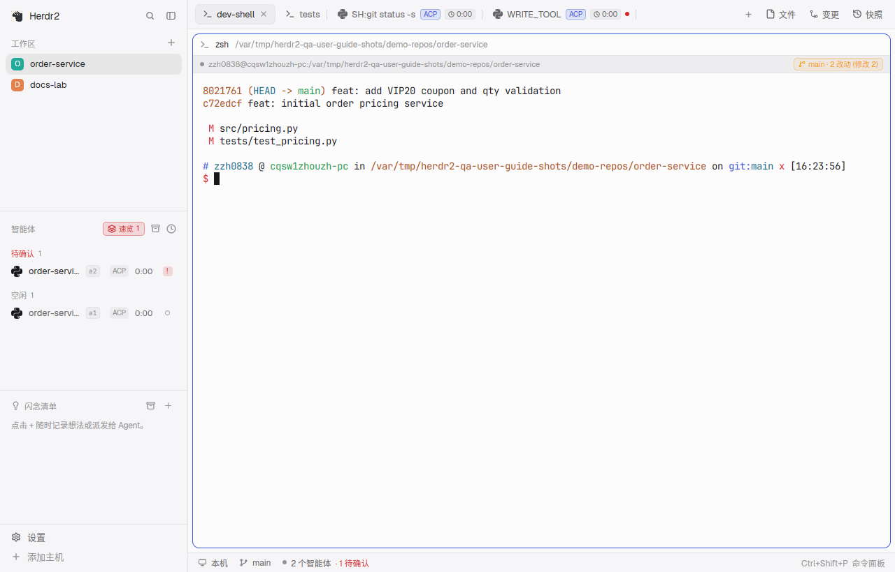
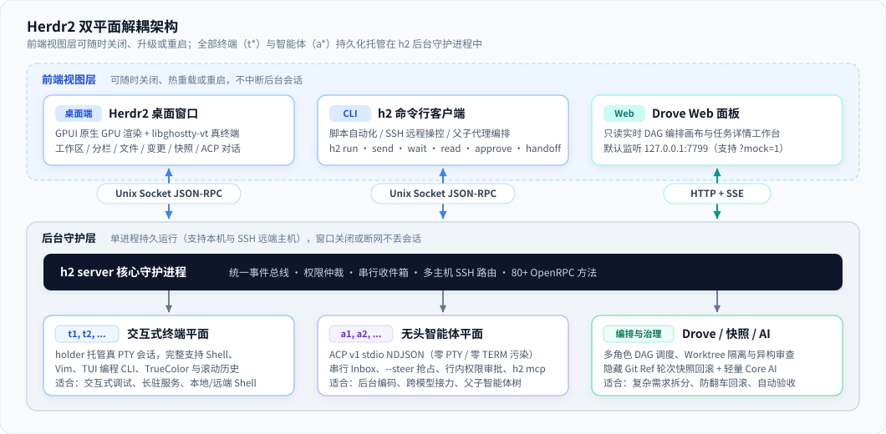
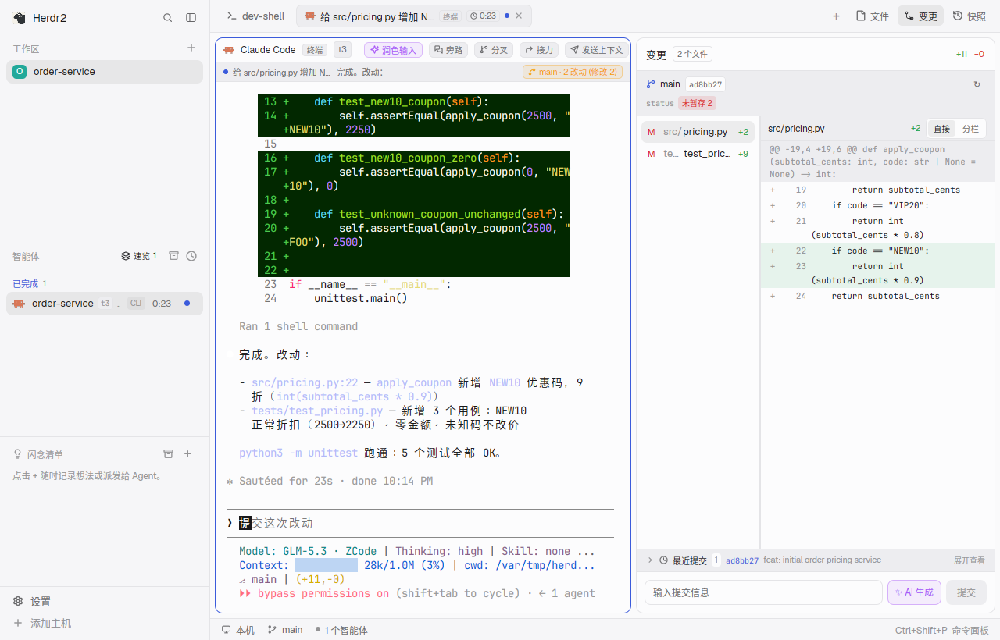
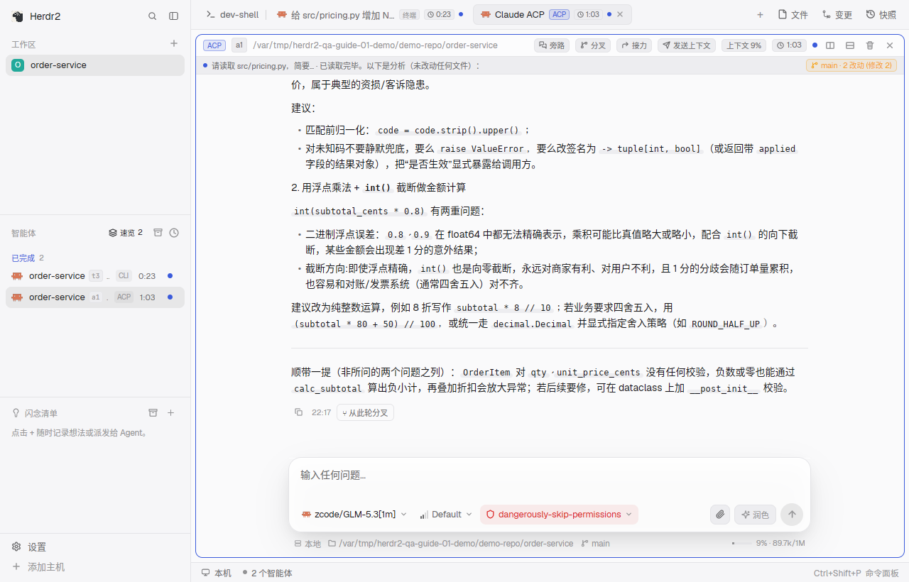
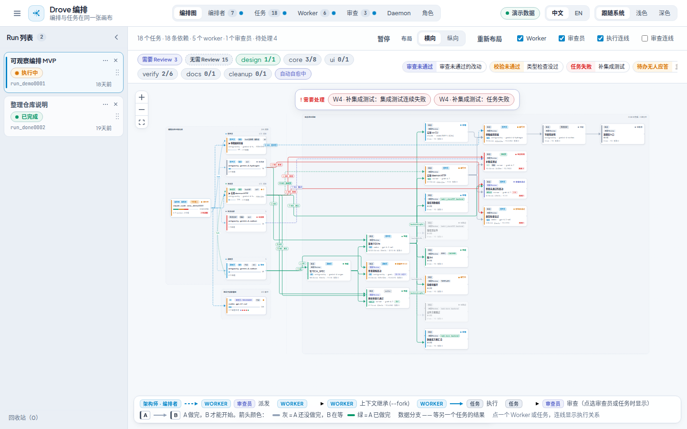

# Herdr2

[简体中文](./README.md) | **English** · 🌐 **Website: [herdr2.work](https://herdr2.work)** · 📦 [GitHub Releases](https://github.com/herdr2/herdr2/releases/latest) · 📖 [User Guide (中文)](./docs/user-guide/README.md) · 📄 [Apache-2.0](./herdr-core/LICENSE)

**A Dual-Plane Workbench and Multi-Agent Orchestration Runtime for AI-Assisted Software Engineering**

Traditional terminal multiplexers (like tmux) keep shells alive, but trap AI coding conversations, code diffs, and permission approvals inside raw ANSI streams. Mainstream IDEs and desktop AI apps look friendly and persist chat history across restarts, yet still bind live local terminals and in-flight agents to the window lifecycle—closing or updating the window interrupts active processes, and you cannot seamlessly inspect or steer them from CLI or SSH.

**Herdr2** cleanly decouples a GPU-accelerated native desktop app (`herdr2`, built on GPUI + `libghostty-vt`) from a persistent background daemon (`h2`). In one window, you get the **100% native CLI Agent TUI experience** (Claude Code, Codex, Gemini, etc.), **headless structured ACP agents**, a **global Core AI hub with in-place Prompt Polish**, and **Drove multi-agent DAG orchestration** driven by a single `/drove` command. Close the window, hot-update the UI, or drop SSH—every terminal and agent keeps running uninterrupted in the background.



---

## Core Capabilities

### 1. Native CLI Experience + Headless ACP Dual-Plane Runtime



- **Native CLI Agent Plane (`t1, t2...`)**: Powered by `libghostty-vt` GPU rendering, **preserving 100% of Claude Code / Codex / Gemini's native TUI, slash commands, and keybindings**—while layering automatic sidebar status tracking (`working` / `blocked` / `done` / `idle`) and live **Files / Changes / Checkpoints** side panels around it.
- **Headless ACP Agent Plane (`a1, a2...`)**: Pure stdio NDJSON over ACP v1 (zero PTY / zero `TERM*` pollution), with **14 built-in agent presets** (`claude`, `codex`, `agy`, `gemini`, `cursor`, `opencode`, `copilot`, `kimi`, `qwen`, `pi`, `hermes`, `dsh`, `glm`, `zcode`), a serialized Inbox, `--steer` live preemption, 4 permission modes (`approve-reads` / `ask` / `approve-all` / `deny-all`), live model/reasoning-effort switching, and a built-in MCP server (`h2 mcp`) for parent-child agent trees.
- **Unified GUI & CLI Control**: Every desktop action maps to standard `herdr2 do` / `h2` RPC calls. Even outside the desktop window (e.g., over SSH or scripts), `h2 ls / read / attach / send / approve` operates directly on the exact same live sessions.

<table>
  <tr>
    <td width="50%">
      
      <p align="center"><b>Native CLI Agent Workflow</b>: Authentic terminal TUI + automatic sidebar tracking + live Git Diff panel</p>
    </td>
    <td width="50%">
      
      <p align="center"><b>Headless ACP Structured Chat</b>: Clean Markdown + fork from any turn + live model &amp; permission switcher</p>
    </td>
  </tr>
</table>

### 2. Global Core AI Hub & In-Place "Prompt Polish"

> [!IMPORTANT]
> **Core AI is the nerve center of Herdr2—strongly recommended to configure during the first-launch Welcome wizard!**
> Works with **DeepSeek Official API** (recommended: `https://api.deepseek.com/v1` + `deepseek-chat`), any OpenAI-compatible gateway, or fully local **Ollama / vLLM**. API keys are stored separately in `ai.key` (`0600`), with automatic secret redaction before outbound calls.

- **✨ AI Prompt Polish (`Ctrl+Alt+P` / macOS `Cmd+Alt+P`)**: Automatically reads live session context (working directory, recent turns, tool outputs, and CLI terminal tail) to rewrite rough spoken notes into structured, unambiguous engineering prompts—working **not only in ACP chat and Flash Notes, but directly in-place inside native CLI terminal input boxes** (supporting multi-line drafts, edit-conflict protection, instant undo via **`Ctrl+Alt+U`** / `Cmd+Alt+U`, and automatic global hotkey conflict fallback).
- **Low-Latency Intelligence Everywhere**: Powers **semantic state arbitration for non-protocol CLI terminals**, one-click **AI Commit Message generation** in the Changes panel, **smart Handoff recommendations & summaries**, **semantic agent titles**, **Catch-up briefings (`agent.briefing`)**, **checkpoint failure bisecting**, and **one-click Drove role auto-setup**.

### 3. Seamless Context Flow & Zero-Pollution Git Checkpoints

- **Four Context-Transfer Modes + Merge Back**:
  - **Handoff**: Distills recent progress and workspace changes into a compact handoff bundle for any other agent or model;
  - **Fork**: Branches off from the current or any historical turn, optionally creating an isolated **Git Worktree**;
  - **Side-chat**: Opens a read-only side panel to ask questions without polluting the main session;
  - **Send Context**: Delivers recent context directly into **another already-running live CLI or ACP agent** (even across workspaces) without spawning a new session;
  - Findings from Forks and Side-chats can be cleanly **Merged Back** into the parent session.
- **Hidden Git Ref Checkpoints**: Stored under `refs/herdr2/...` with **zero temporary commits and zero Git history pollution**—giving you pure per-turn diffs, dual conversation + workspace rollback, and natural-language `h2 checkpoint bisect`.

### 4. Drove Multi-Agent DAG Orchestration: Plan First, Then `/drove`

No hand-authored `plan.yaml` or memorizing orchestration flags. After a 30-second one-click team setup in **Settings → Drove** (**Refresh Agents** + **AI Auto-Configure**):
1. **Plan with your main agent first**, aligning on module boundaries and verification commands;
2. Send **`/drove`**—your main agent becomes the Coordinator, turns the plan into a dependency-aware DAG, and dispatches specialized headless ACP sub-agents (`coder` / `tester` / `writer` / `illustrator` / `reviewer` / `researcher`);
3. Need follow-up work mid-run or after completion? Send **`/drove-add`** to hot-append tasks reusing warm idle workers.

Backed by four engineering guardrails: **OS-level role sandboxing** (Linux `bwrap` / macOS `sandbox-exec` / Windows Restricted Token), **multi-candidate model fallback**, **Git Worktree preflight & merge isolation**, and **adversarial heterogeneous code review with a 3-stage Review Circuit-Breaker** (auto-escalates to coordinator takeover after 2 failed rounds, then hard-stops for user decision if post-handoff review still disagrees).

Includes the built-in **7-Tab Drove Web Workbench** (`http://127.0.0.1:7799`, try `?mock=1` for instant interactive demo data): **DAG Graph** · **Coordinator** · **Tasks** · **Workers** · **Reviews** · **Daemon Control Plane** · **Roles Matrix**.



### 5. Multi-Machine Federation, File-Level Hot Reload & OTA Updates

- **SSH Multi-Machine Federation**: Manage local, WSL, and remote Linux/macOS servers inside one window; `Ctrl+V` automatically syncs pasted screenshots to remote terminals, and Drove Web aggregates remote `<machine>/<run_id>` runs over SSE.
- **Everything in the UI Is a Hot-Reloadable Local File**: Ships with `Herdr2`, `Terminals`, and `Herdr 98` layouts; edits to `layouts/*.json`, `mods/*`, `keys.json`, and `themes/*.json` reload live without interrupting terminals (unoverridable escape hatch: `Ctrl+Alt+Shift+Esc`).
- **In-App OTA Hot Updates & Zero-Conflict Coexistence**: One-click app/core upgrades plus ~200ms zero-restart UI bundle hot updates; isolated binaries (`h2` / `herdr2`) and config paths coexist cleanly alongside upstream `hc` / `herdr-app`.

---

## Quick Installation

Visit **[herdr2.work](https://herdr2.work)** or get up and running in under a minute:

### Option A (Recommended): One-Stop Install via Your AI Coding Assistant

Send this prompt to your AI agent (Antigravity, Claude Code, Codex, Cursor, OpenCode, etc.) to run the bundled [`herdr2-install` Skill](./skills/herdr2-install/SKILL.md):

```text
Please read https://raw.githubusercontent.com/herdr2/herdr2/main/skills/herdr2-install/SKILL.md and follow the steps to install and configure Herdr2 on this machine.
```

### Option B: Manual Platform Installers

| Platform | Command / Installer |
| --- | --- |
| **macOS (Apple Silicon)** | `curl -fsSL https://github.com/herdr2/herdr2/releases/download/ota-latest/app-install.sh \| sh` (or `.dmg` from [Releases](https://github.com/herdr2/herdr2/releases/latest)) |
| **Linux (Debian / Ubuntu)** | Download `herdr2_<ver>_amd64.deb` from [Releases](https://github.com/herdr2/herdr2/releases/latest) and run `sudo apt-get install -y ./herdr2_<ver>_amd64.deb` |
| **Linux (Any Distro / No sudo)** | `curl -fsSL https://github.com/herdr2/herdr2/releases/download/ota-latest/app-install.sh \| sh` |
| **Headless Linux Server / Inside WSL** | `curl -fsSL https://github.com/herdr2/herdr2/releases/download/ota-latest/core-install.sh \| sh` (`h2` daemon & CLI only) |
| **Windows (x64)** | Run `Herdr2-Setup-<ver>-windows-x86_64.exe` from [Releases](https://github.com/herdr2/herdr2/releases/latest) (no admin rights needed), or in PowerShell: `irm https://github.com/herdr2/herdr2/releases/download/ota-latest/app-install.ps1 \| iex` |

Verify your installation and inject the companion skills (`herdr2`, `/drove`, `/drove-add`, `/drove-setup`) into local coding agents:

```bash
h2 --version && herdr2 --version
h2 server start && h2 server status
h2 skill install --all
```

Launch `Herdr2` and **complete the Global Core AI setup in the Welcome wizard** to unlock Prompt Polish and the full intelligent workflow!

---

## Documentation

### User Guide (Recommended Starting Point)

The full illustrated handbook (currently in Chinese, verified in an isolated QA sandbox with 20+ real screenshots and diagrams) lives at **[docs/user-guide/README.md](./docs/user-guide/README.md)**:

1. **[01. Installation, Quick Start & UI Tour](./docs/user-guide/01-getting-started.md)** — Multi-platform install, dual-plane architecture, essential Core AI welcome wizard, annotated 5 UI zones, live Claude Code CLI + Prompt Polish + ACP walkthrough
2. **[02. Workspaces, Terminals & Code Panels](./docs/user-guide/02-workspaces-and-terminals.md)** — Spaces/Tabs/Panes, shortcut cheat sheet, Ghostty PTY + `h2`, Files & Git Changes panels, Flash Notes
3. **[03. Headless ACP Agents & Permissions](./docs/user-guide/03-headless-acp-agents.md)** — 14 presets, structured chat view, serialized Inbox & `--steer`, 4-level permission control, live model switching, built-in MCP
4. **[04. Global Core AI, Prompt Polish, Handoff & Checkpoints](./docs/user-guide/04-handoff-checkpoints-and-ai.md)** — **Essential Core AI hub**, **AI Prompt Polish deep dive (in-place CLI polish & undo)**, Handoff / Fork / Side-chat / Send Context, hidden Git Ref checkpoints
5. **[05. Drove Multi-Agent DAG Orchestration](./docs/user-guide/05-drove-orchestration.md)** — One-click role setup, **Plan → `/drove` → `/drove-add` workflow**, Review Circuit-Breaker, full tour of all 7 Drove Web workbench tabs
6. **[06. Remote Hosts, Customization & Automated QA](./docs/user-guide/06-remote-customization-and-qa.md)** — SSH multi-machine federation, 3 layouts & hot-reloading Mods, `herdr2 do / shot` automation & isolated sandbox QA

### Architecture & References

- [Herdr2 Architecture & Principles](./docs/herdr2-architecture-and-principles.md) · [Usage & Coexistence Guide](./docs/herdr2-usage-guide.md) · [Drove Architecture](./docs/drove-architecture.md)
- [Core Runtime](./herdr-core/README.md) · [Desktop App](./herdr-app/README.md) · [Drove Web](./drove-web/README.md) · [Living QA Catalog (19 features / 90 cases)](./qa/CATALOG.md)

---

## Repository Structure

```text
herdr2/
├── herdr-core/       # Rust background daemon & CLI (h2 / herdr2-core): ACP, PTY holder, Checkpoints, Core AI, Drove engine
├── herdr-app/        # GPUI + libghostty-vt native desktop app, hot-reloading Layouts / Mods / Frame & OTA updater
├── drove-web/        # 7-tab Drove visual orchestration workbench frontend (Vite + TypeScript)
├── skills/           # Bundled Agent Skills (herdr2-install / drove / drove-add / drove-setup / herdr2-qa / herdr2-release)
├── docs/             # User Guide (docs/user-guide/) and architecture documentation
├── qa/               # Living feature inventory (features.yaml), tiered cases, and generated CATALOG.md
└── scripts/          # Local dev hot-sync (dev.sh / dev.ps1), release packaging, and isolated sandbox QA runner (scripts/qa/)
```

---

## Building from Source & Development

Prerequisites: Rust (workspace edition 2024), Zig (for building `ghostty-sys` in `herdr-app`), [just](https://github.com/casey/just), and Node.js / [Bun](https://bun.sh).

```bash
# 1. Build background daemon & CLI (herdr-core)
cd herdr-core && cargo build --locked -p herdr2

# 2. Build Drove Web static assets
cd ../drove-web && npm install && npm run build

# 3. Build native desktop app (herdr-app)
cd ../herdr-app && cargo build --locked
```

The root [justfile](./justfile) provides incremental dev, hot-reload, and zero-pollution sandbox QA commands:

```bash
just dev-ui                     # Zero-compile hot-reload for JS Mods / Layouts / Themes
just dev-web                    # Live watch build for Drove Web
just dev-core                   # Incremental build of herdr-core with zero-downtime h2 server restart
just dev-app                    # Incremental build of herdr-app & window relaunch (terminals stay alive)
just hot-sync all               # One-command WSL + Windows hot-sync build & deploy
just test                       # Full test suite across scripts, herdr-core, and herdr-app
just qa-drift                   # Verify 0-drift sync between code contracts and QA catalog
just qa-run --tier L0,L1,L2,L3  # Run tiered automated QA regression & screenshots in an isolated sandbox
```

---

## Acknowledgments

Herdr2 stands on the shoulders of giants. Heartfelt thanks to the following open-source projects and communities:

### Special Thanks: Upstream **Herdr**

Deep gratitude to the author and contributors of the original **Herdr** project ([`herdrdev/herdr-app`](https://github.com/herdrdev/herdr-app) & [`herdrdev/herdr-core`](https://github.com/herdrdev/herdr-core))!

Herdr laid an extraordinarily clean and solid foundation for Herdr2, including:
- The **decoupled desktop UI + persistent core daemon** architecture—so closing a window never interrupts your work;
- The **GPUI + `libghostty-vt`** native cross-platform terminal experience and **Space / Tab / Pane** workspace model;
- The **"everything in the UI is a hot-reloadable local file"** customization philosophy (Layouts, Mods, Keys, Themes) and clean **SSH multi-machine federation**.

Herdr2 builds upon this foundation to explore headless ACP v1 agents, inline permission arbitration, a global Core AI hub with in-place CLI Prompt Polish, cross-model context flows (Handoff / Fork / Side-chat / Send Context), hidden Git Ref checkpoints, native Drove multi-agent DAG orchestration, and a 7-tab live observability Web workbench—while deliberately keeping all binaries, config paths, and runtime sessions isolated from upstream Herdr so both can coexist seamlessly. If you enjoy Herdr2's native desktop and terminal design, please check out and support the original **[Herdr](https://github.com/herdrdev/herdr-app)** project!

### Other Key Open-Source Projects

- **[GPUI](https://www.gpui.rs/)** & **[gpui-kit](https://gpui-kit.com/)** — High-performance Rust GPU UI framework and scriptable shell
- **[Ghostty](https://ghostty.org/)** (`libghostty-vt`) — Fast, modern, spec-compliant terminal emulation core
- **[Agent Client Protocol (ACP)](https://agentclientprotocol.com/)** — Open protocol for structured coding-agent communication

---

## License

Licensed under the [Apache-2.0](./herdr-core/LICENSE) License.
