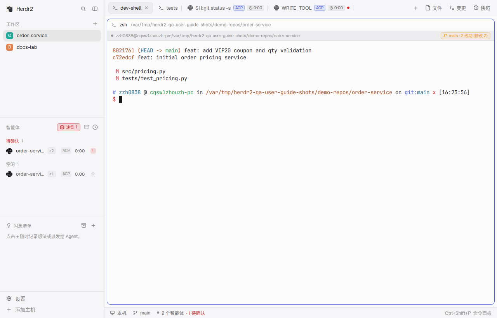
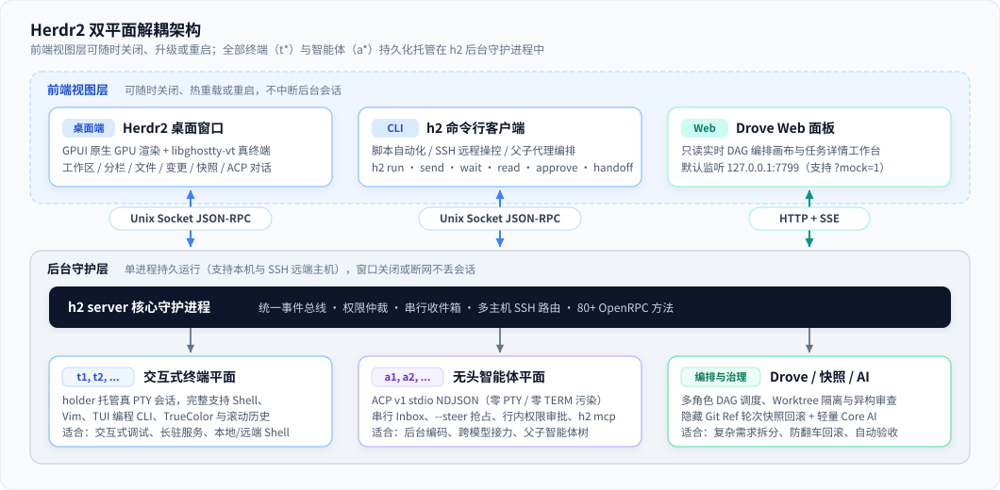
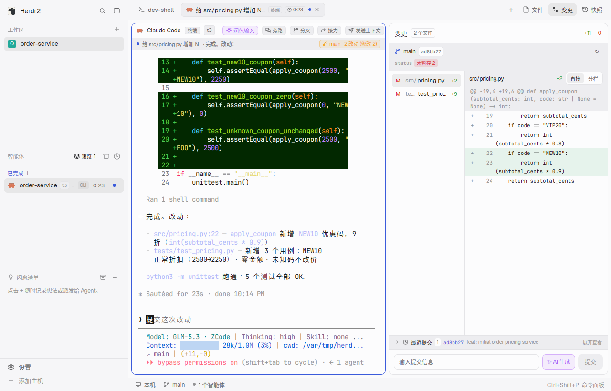
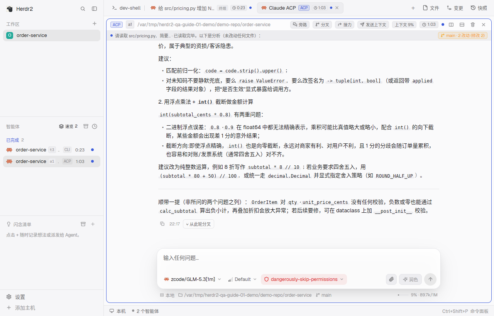
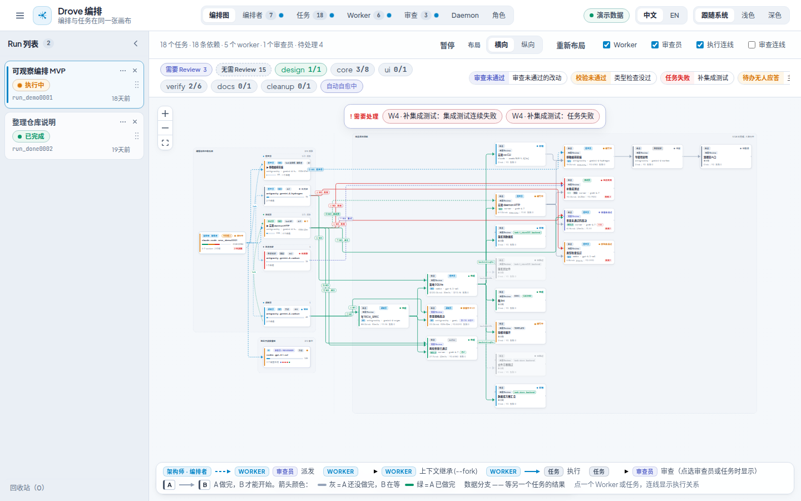

# Herdr2

**简体中文** | [English](./README.en.md) · 🌐 **官网：[herdr2.work](https://herdr2.work)** · 📦 [GitHub Releases](https://github.com/herdr2/herdr2/releases/latest) · 📖 [用户使用手册](./docs/user-guide/README.md) · 📄 [Apache-2.0](./herdr-core/LICENSE)

**面向 AI 辅助软件工程的双平面工作台与多智能体编排运行时**

传统终端复用器（如 tmux）擅长持久托管 Shell，却把 AI 编程工具的对话、代码 diff 和审批卡死在 ANSI 字符流里；主流 IDE 或 AI 桌面工具虽然可视化友好且能保存历史会话，但运行中的本地终端与 Agent 仍与窗口生命周期绑定——关窗重启会中断进程，也难以脱离 GUI 从 CLI / SSH 直接查看和操控。

**Herdr2** 将高性能原生 GPU 桌面端（`herdr2`，GPUI + `libghostty-vt`）与后台持久守护进程（`h2`）彻底解耦：让你在同一个窗口里**原汁原味运行 Claude Code / Codex / Gemini 等原生 CLI Agent**、并行调度**无头结构化 ACP 智能体**、借助**全局 Core AI 与原地「润色输入」**大幅提效，并用一句 **`/drove`** 指挥一整支带权限护栏与异构审查的 AI 工程小队。关闭窗口、热更新界面甚至断开 SSH，所有终端与智能体仍在后台持续运行。



---

## 核心能力一览

### 1. 原生 CLI 体验 + 无头 ACP 双平面，后台永不掉线



- **原生 CLI Agent 平面（`t1, t2...`）**：内置 `libghostty-vt` GPU 真终端，**100% 保留 Claude Code / Codex / Gemini 等工具的原生 TUI 界面、斜杠命令与快捷键手感**；同时在窗口侧栏自动追踪运行状态（运行中 / 待确认 / 已完成 / 空闲），右侧「文件」「变更」「快照」面板无缝联动。
- **无头 ACP 智能体平面（`a1, a2...`）**：基于 ACP v1 纯 stdio NDJSON（零 PTY / 零 `TERM*` 污染），开箱支持 **14 种内置预设**（`claude`、`codex`、`agy`、`gemini`、`cursor`、`opencode`、`copilot`、`kimi`、`qwen`、`pi`、`hermes`、`dsh`、`glm`、`zcode`）；提供结构化对话、串行收件箱（Inbox）、`--steer` 中途插话、四档权限审批（`approve-reads` / `ask` / `approve-all` / `deny-all`）、免重启热切模型/思考强度，以及内置 MCP 服务器（`h2 mcp`）支撑父子智能体树。
- **CLI 与 GUI 同源**：桌面操作与 `h2` / `herdr2 do` 命令完全互通；即使脱离桌面窗口（如 SSH 连回本机），依然可用 `h2 ls / read / attach / send / approve` 直接查看和操控同一批会话。

<table>
  <tr>
    <td width="50%">
      
      <p align="center"><b>原生 CLI Agent 开发</b>：保留原汁原味终端体验 + 自动状态追踪 + 实时 Git Diff 面板</p>
    </td>
    <td width="50%">
      
      <p align="center"><b>无头 ACP 结构化对话</b>：纯净排版 + 从任意轮次分叉 + 底部热切模型与权限</p>
    </td>
  </tr>
</table>

### 2. 全局 Core AI 核心中枢与「✨ 润色输入」

> [!IMPORTANT]
> **AI 能力是 Herdr2 的核心神经中枢，强烈建议在首次启动向导中立即配置全局 Core AI！**
> 支持 **DeepSeek 官方 API**（推荐：`https://api.deepseek.com/v1` + `deepseek-chat`）、任意 OpenAI 兼容网关，或完全离线的本机 **Ollama / vLLM**；密钥以 `0600` 权限单独存放于 `ai.key`，并支持发送前敏感凭据自动脱敏。

- **✨ AI 润色输入（`Ctrl+Alt+P` / macOS `Cmd+Alt+P`）**：结合当前工作目录、近期对话轮次与终端屏幕上下文，把碎片化口语一键改写成结构清晰、含约束的工程指令——**不仅支持 ACP 对话框与闪念清单，更支持在原生 CLI 终端输入框内直接原地替换**（支持多行与防误覆盖保护，按 **`Ctrl+Alt+U`** / `Cmd+Alt+U` 一秒反悔还原，系统热键冲突时自动避让）。
- **全链路低延迟智能赋能**：同时驱动**非协议 CLI 终端语义状态仲裁**、右侧变更面板 **AI 一键生成 Commit Message**、**接力智能推荐与交接摘要**、**智能体语义标题**、**Catch-up 回归简报（`agent.briefing`）**、**快照故障定位**与 **Drove 角色一键配置**。

### 3. 上下文自由流转与零污染 Git 快照

- **四种上下文流转 + 逆向合回**：
  - **上下文接力（Handoff）**：提炼近期进展与工作区改动为精简交接包，无缝交棒给任意其他 Agent / 模型；
  - **会话分叉（Fork）**：从当前或任意历史轮次开启平行分支，可选自动创建隔离 **Git Worktree**；
  - **旁路讨论（Side-chat）**：在右侧只读侧栏随时核对原理、不污染主会话；
  - **发送上下文（Send Context）**：不新建会话，直接把当前近期上下文打包投递给**另一个已开启的在线 CLI 或 ACP Agent**（支持跨工作区）；
  - 分叉与旁路结论还支持一键 **合回父会话（Merge Back）**。
- **隐藏 Git Ref 快照（Checkpoints）**：存于 `refs/herdr2/...`，**不产生临时 Commit、不污染正常 Git 分支历史**；支持逐轮纯净 Diff、对话与工作区双轨一键回滚，以及自然语言故障定位（`h2 checkpoint bisect`）。

### 4. Drove 多智能体 DAG 编排：先 Plan，再 `/drove`

无需手写 `plan.yaml` 或背诵调度命令——在「设置 → Drove」点击 **「刷新 Agent」+「AI 一键配置」** 配好角色团队后：
1. **先和主力 Agent 聊清方案（Plan）**，对齐模块拆分与验收命令；
2. 发一句 **`/drove`**，主 Agent 自动拆解并行 DAG 并派生专业无头子智能体（`coder` / `tester` / `writer` / `illustrator` / `reviewer` / `researcher`）并发施工；
3. 中途或完工后想加需求，发一句 **`/drove-add`** 热追加任务，直接复用热待命（warm idle）Worker。

内置四重工程护栏：**OS 级角色权限沙盒**（Linux `bwrap` / macOS `sandbox-exec` / Windows Restricted Token）、**多候选模型故障顺延**、**Git Worktree 并发隔离与合并**，以及**异构交叉审查 + 三段式 Review 熔断机制**（连续 2 轮不通过自动转交主 Agent 亲自接管，终审复核仍不过即硬熔断上报用户拍板）。

配套内置 **Drove Web 7 大可视化工作台**（`http://127.0.0.1:7799`，支持 `?mock=1` 零门槛演示数据）：**编排图** · **编排者** · **任务** · **Worker** · **审查** · **Daemon 控制面** · **角色路由矩阵**。



### 5. 多机合一、文件级热定制与 OTA 热更新

- **SSH 多机联邦**：将本机、WSL 与远程 Linux / macOS 服务器统一汇入同一桌面窗口；远程终端支持 `Ctrl+V` 自动同步剪贴板图片，Drove Web 自动聚合远端 Run。
- **一切界面皆可热重载本地文件**：内置 `Herdr2` / `Terminals` / `Herdr 98` 三套布局，所有 `layouts/*.json`、`mods/*`、`keys.json`、`themes/*.json` 修改后秒级热生效、不中断任何终端（永不失效逃生舱：`Ctrl+Alt+Shift+Esc`）。
- **应用内 OTA 热更新 & 零冲突共存**：支持应用/核心一键升级与约 200ms 免重启 UI 热更新；独立二进制名（`h2` / `herdr2`）与配置目录，可与原版 `hc` / `herdr-app` 长期并行共存。

---

## 快速安装

前往官网 **[herdr2.work](https://herdr2.work)** 了解更多，或直接按以下任一方式在 1 分钟内完成安装：

### 方式 A（推荐）：交给你的 AI 编程助手一站式安装

把下面这句话发给你正在用的 AI Agent（Antigravity、Claude Code、Codex、Cursor、OpenCode 等），它会基于仓库内置的 [`herdr2-install` Skill](./skills/herdr2-install/SKILL.md) 自动完成全流程：

```text
请阅读 https://raw.githubusercontent.com/herdr2/herdr2/main/skills/herdr2-install/SKILL.md 并按步骤在本机安装和配置 Herdr2。
```

### 方式 B：按平台手动安装

| 平台 | 推荐安装命令 / 安装包 |
| --- | --- |
| **macOS（Apple Silicon）** | `curl -fsSL https://github.com/herdr2/herdr2/releases/download/ota-latest/app-install.sh \| sh`（或下载 [Releases](https://github.com/herdr2/herdr2/releases/latest) 中的 `.dmg`） |
| **Linux（Debian / Ubuntu）** | 从 [Releases](https://github.com/herdr2/herdr2/releases/latest) 下载 `herdr2_<ver>_amd64.deb` 并执行 `sudo apt-get install -y ./herdr2_<ver>_amd64.deb` |
| **Linux（通用 / 无 sudo）** | `curl -fsSL https://github.com/herdr2/herdr2/releases/download/ota-latest/app-install.sh \| sh` |
| **无头 Linux 服务器 / WSL 内部** | `curl -fsSL https://github.com/herdr2/herdr2/releases/download/ota-latest/core-install.sh \| sh`（仅安装 `h2` 守护进程与 CLI） |
| **Windows（x64）** | 下载 [Releases](https://github.com/herdr2/herdr2/releases/latest) 中的 `Herdr2-Setup-<ver>-windows-x86_64.exe` 双击安装（无需管理员权限），或在 PowerShell 运行 `irm https://github.com/herdr2/herdr2/releases/download/ota-latest/app-install.ps1 \| iex` |

安装完成后验证环境并注入配套 Skills（让本机编码 Agent 原生支持 `herdr2`、`/drove`、`/drove-add`、`/drove-setup`）：

```bash
h2 --version && herdr2 --version
h2 server start && h2 server status
h2 skill install --all
```

然后启动 `Herdr2` 桌面应用，**按欢迎向导完成全局 Core AI 配置**即可开跑！

---

## 文档导航

### 用户使用手册（推荐从这里开始）

完整分主题图文教程见 **[docs/user-guide/README.md](./docs/user-guide/README.md)**（全部流程均经隔离沙盒实操复现，含 20+ 张实机截图与架构矢量图）：

1. **[01. 安装、快速上手与界面导览](./docs/user-guide/01-getting-started.md)** — 多平台安装、双平面架构、必配 Core AI 欢迎向导、主界面 5 大区域标注、原生 Claude Code CLI + 润色输入 + ACP 实机闭环
2. **[02. 工作区、终端与代码面板](./docs/user-guide/02-workspaces-and-terminals.md)** — 工作区/标签页/分栏、核心快捷键速查、Ghostty 真终端与 `h2` 托管、文件与 Git 变更面板、闪念清单
3. **[03. 无头 ACP 智能体与权限控制](./docs/user-guide/03-headless-acp-agents.md)** — 14 种内置预设、结构化对话视图、串行 Inbox 与 `--steer`、四档权限审批、热切模型与内置 MCP
4. **[04. 全局 Core AI、润色输入、接力与快照](./docs/user-guide/04-handoff-checkpoints-and-ai.md)** — **必配 Core AI 中枢**、**AI 润色输入深度指南（含原生 CLI 原地润色与撤销）**、接力/分叉/旁路/发送上下文、隐藏 Git Ref 快照与故障定位
5. **[05. Drove 多智能体 DAG 编排](./docs/user-guide/05-drove-orchestration.md)** — 桌面角色一键配置、**先 Plan 再 `/drove` 编排**、`/drove-add` 热追单、Review 熔断协议、Drove Web 7 大工作台全览
6. **[06. 远程主机、深度定制与自动化自检](./docs/user-guide/06-remote-customization-and-qa.md)** — SSH 多机联邦、三套布局与 Mods 热重载、`herdr2 do / shot` 自动化与隔离沙盒 QA 框架

### 架构与参考文档

- [Herdr2 架构与实现原理](./docs/herdr2-architecture-and-principles.md) · [使用与共存指南](./docs/herdr2-usage-guide.md) · [Drove 编排架构](./docs/drove-architecture.md)
- [Core 运行时](./herdr-core/README.md) · [桌面端](./herdr-app/README.md) · [Drove Web](./drove-web/README.md) · [QA 活体测试目录（19 项特性 / 90 用例）](./qa/CATALOG.md)

---

## 仓库结构

```text
herdr2/
├── herdr-core/       # Rust 后台守护进程与 CLI（h2 / herdr2-core）：ACP、PTY holder、快照、Core AI、Drove 引擎
├── herdr-app/        # GPUI + libghostty-vt 原生桌面端、热重载 Layouts / Mods / Frame 与 OTA 更新
├── drove-web/        # Drove 7 页签可视化编排工作台前端（Vite + TypeScript）
├── skills/           # 内置配套 Agent Skills（herdr2-install / drove / drove-add / drove-setup / herdr2-qa / herdr2-release）
├── docs/             # 用户使用手册（docs/user-guide/）与架构设计文档
├── qa/               # 活体功能清单（features.yaml）、分层用例与自动生成的 CATALOG.md
└── scripts/          # 本地开发热同步（dev.sh / dev.ps1）、发布打包与隔离沙盒 QA 运行器（scripts/qa/）
```

---

## 从源码构建与开发

环境要求：Rust（workspace edition 2024）、Zig（用于 `herdr-app` 构建 `ghostty-sys`）、[just](https://github.com/casey/just)、Node.js / [Bun](https://bun.sh)。

```bash
# 1. 构建后台守护进程与 CLI（herdr-core）
cd herdr-core && cargo build --locked -p herdr2

# 2. 构建 Drove Web 静态产物
cd ../drove-web && npm install && npm run build

# 3. 构建原生桌面应用（herdr-app）
cd ../herdr-app && cargo build --locked
```

根目录 [justfile](./justfile) 提供完整的增量开发、热重载与零污染隔离沙盒 QA 命令：

```bash
just dev-ui                     # 零编译热重载 JS Mods / Layouts / 主题
just dev-web                    # Drove Web 前端实时监听构建
just dev-core                   # 增量编译 herdr-core 并零中断重启 h2 server
just dev-app                    # 增量编译 herdr-app 并重启窗口（后台终端不中断）
just hot-sync all               # WSL + Windows 一键热同步构建与部署
just test                       # 运行 scripts、herdr-core 与 herdr-app 全量测试
just qa-drift                   # 校验代码契约与 QA 用例目录同步（0 漂移）
just qa-run --tier L0,L1,L2,L3  # 在完全隔离沙盒中运行分层自动化 QA 回归与截图
```

---

## 致谢（Acknowledgments）

Herdr2 站在巨人的肩膀上成长，在此向以下开源项目与社区致以最诚挚的感谢：

### 特别鸣谢：原版 **Herdr** 项目

衷心感谢原版 **Herdr**（[`herdrdev/herdr-app`](https://github.com/herdrdev/herdr-app) 与 [`herdrdev/herdr-core`](https://github.com/herdrdev/herdr-core)）的作者与全体贡献者！

Herdr 在设计理念与工程实现上为 Herdr2 奠定了极其坚实而优雅的基石，包括但不限于：
- **「桌面窗口与核心守护进程解耦」** 的核心架构哲学——让关闭窗口不再意味着中断工作流；
- 基于 **GPUI + `libghostty-vt`** 精心打磨的高性能原生跨平台终端桌面体验，以及 **Space / Tab / Pane** 清晰的工作区组织模型；
- 极具创造力的 **「一切界面皆本地可热重载文件」**（Layouts、Mods、Keys 与 Themes）定制体系，以及简洁直观的 **SSH 多机联邦** 设计。

Herdr2 在此基础上进一步探索了无头 ACP v1 智能体平面、行内权限仲裁、全局 Core AI 与原生终端原地「润色输入」、跨模型上下文流转（接力/分叉/旁路/发送上下文）、隐藏 Git Ref 轮次快照、原生 Drove 多智能体 DAG 编排与 7 页签可观测 Web 工作台等方向，并刻意保持与原版 Herdr 的命名与运行环境完全隔离，以示对上游项目的尊重并方便用户并行体验。如果你喜欢 Herdr2 的原生桌面与终端设计，请一定去关注并支持原版 **[Herdr](https://github.com/herdrdev/herdr-app)** 项目！

### 其他关键开源项目

- **[GPUI](https://www.gpui.rs/)** & **[gpui-kit](https://gpui-kit.com/)** — 高性能 Rust GPU UI 框架与脚本化外壳
- **[Ghostty](https://ghostty.org/)**（`libghostty-vt`）— 现代、高速、规范兼容的终端仿真核心
- **[Agent Client Protocol (ACP)](https://agentclientprotocol.com/)** — 开放的结构化编程智能体通信协议

---

## 许可证

本项目遵循 [Apache-2.0](./herdr-core/LICENSE) 开源许可证。
