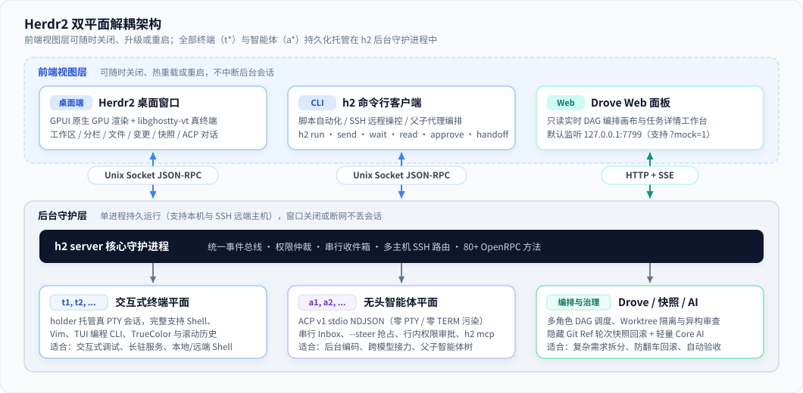
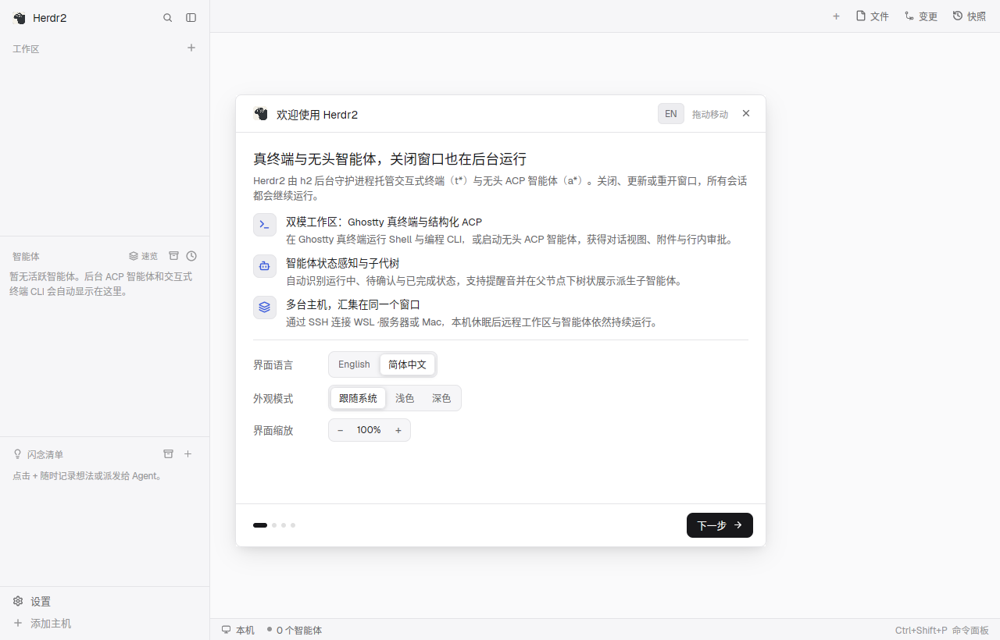
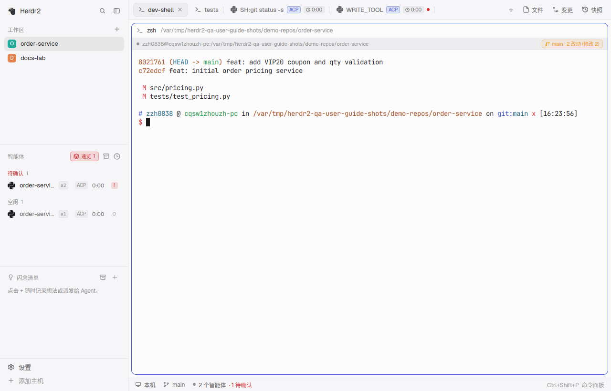
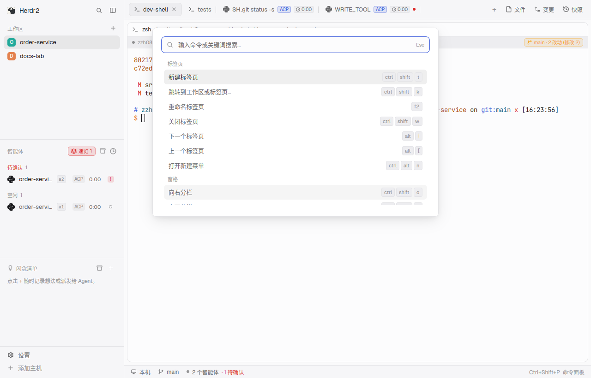

# 01. 快速上手与界面导览

> 本篇带你理解 Herdr2 的核心架构、完成首次启动与初始偏好设置，并用 5 分钟走完「建工作区 → 跑命令 → 用命令面板掌控全局」的第一个完整闭环。

---

## 1. 为什么是「双平面」架构？

传统终端复用器（如 tmux）擅长持久托管 Shell，却把 AI 编程工具的对话、代码 diff 和审批卡死在 ANSI 字符流里；主流 IDE 或 AI 桌面工具虽然可视化友好，重启后也能保留历史会话，但运行中的本地终端与 Agent 往往与窗口生命周期绑定——关闭窗口、更新重启或断开远程连接时，正在跑的进程仍会被中断，也难以直接从 CLI 接管。

Herdr2 将整个系统拆分为两个解耦组件：



带来的直接好处：
1. **永不掉线**：误关窗口、升级 Herdr2 桌面版、甚至合上笔记本断开 SSH，你的本地或远程终端与 Agent 都在 `h2` 后台继续干活。
2. **一屏管多机**：本机、WSL、Linux 编译服务器与 macOS 可以同时接入同一个桌面窗口，像切换本地文件夹一样切换不同主机上的工作区。
3. **CLI 与 GUI 同源**：桌面上的每一个点击都对应一条标准命令（`herdr2 do <command>`）或底层 `h2` RPC，既能点鼠标也能写脚本。

---

## 2. 首次启动与欢迎向导

### 2.1 启动桌面端与检查后台服务

在终端中确认 `h2`（核心守护进程与 CLI）已就绪：

```bash
# 查看 h2 守护进程状态（如未启动会自动拉起）
h2 server start
h2 server status
```

然后直接启动 `Herdr2` 桌面应用。首次打开时，Herdr2 会展示**欢迎向导（Welcome）**：



在欢迎向导第一页，你可以即时调整三项全局体验（**无需重启，立即生效**）：
- **界面语言**：在 `English` 与 `简体中文` 之间实时切换（后续也可在「设置 → 外观」或通过命令 `app.language` 随时切换）。
- **外观模式**：选择 `跟随系统`、`浅色` 或 `深色`。
- **界面缩放**：按 `-` / `+` 调整全局字号与 UI 缩放比例（日常也可用 `Ctrl+=` / `Ctrl+-` / `Ctrl+0` 随时微调）。

> [!TIP]
> 以后如果想重新打开欢迎向导，只需按 `Ctrl+Shift+P` 打开命令面板，输入「欢迎」或运行 `herdr2 do app.welcome` 即可。

---

## 3. 主界面五大核心区域

完成向导并打开你的第一个项目目录后，你将看到 Herdr2 默认布局（`main`）的完整工作台：



对照上图，整个窗口由 **5 个清晰的功能区** 组成：

1. **左上「工作区（Spaces）」列表**：
   - 每个工作区代表一个项目目录（例如图中的 `order-service` 和 `docs-lab`），如果是远程 SSH 主机的工作区，会按主机自动分组。
   - 点击右侧 `+` 可新建工作区；拖曳工作区条目可调整排序；点击顶部搜索图标可快速跳转。
2. **左中「智能体（Agents）」实时状态栏**：
   - 汇聚所有活跃的 **ACP 无头智能体（`a*`）** 与 **交互式终端里的编程 CLI**。
   - 自动按紧急程度分组置顶：**待确认（Blocked，红标 `!`） > 已完成（Done） > 运行中（Working） > 空闲（Idle）**。
   - 如果某个主 Agent 派生了子 Agent，会在父节点下方折叠为树状子列表，点击左侧展开箭头即可查看。
   - 顶部提供「速览」红标胶囊（快速跳转待处理会话）、回收站图标（误删会话可恢复）与历史入口。
3. **左下「闪念清单（Flash Notes）」与全局入口**：
   - 随时按 `+` 记下一条灵感或待办，并在合适时机一键派发给任意 Agent 执行。
   - 最底部固定「设置（`Ctrl+,`）」与「添加主机（SSH）」入口。
4. **顶部「标签栏」与右侧面板开关**：
   - 左侧展示当前工作区的所有标签页（如 `dev-shell`、`tests`，以及打开为标签页的 ACP 对话 `a1`、`a2`），支持点击 `+` 从菜单新建 Shell 或直接启动已安装的 AI CLI / ACP 智能体。
   - 右上角固定三个工作区辅助面板开关：**文件**、**变更**、**快照**，随开随关且按工作区记住状态。
5. **中央「主工作区」与底部「状态栏」**：
   - 中央以卡片形式承载单个或多个分栏的真终端 / ACP 对话窗口；卡片头直接显示当前目录与 Git 分支/未提交改动数（如 `main · 2 改动`）。
   - 底部状态栏汇总当前主机、Git 分支、活跃智能体与待确认计数，右侧提示 `Ctrl+Shift+P 命令面板`。

---

## 4. 命令面板：记住这一个快捷键就够了

刚接触 Herdr2 时，不必死记硬背所有快捷键。按下 **`Ctrl+Shift+P`**（macOS 同理或见快捷键设置），即可呼出**命令面板（Command Palette）**：



命令面板支持**中英文模糊搜索**，列出全部 94 条应用命令及其对应的快捷键徽标：
- 输入 `分栏` 或 `split` → 找到「向右分栏（`Ctrl+Shift+O`）」「向下分栏（`Ctrl+Shift+E`）」。
- 输入 `变更` 或 `changes` → 打开 Git Diff 与提交面板。
- 输入 `接力` 或 `handoff` → 呼出上下文接力 / 会话分叉弹窗。
- 输入 `布局` 或 `layout` → 切换 `Herdr2` / `Terminals` / `Herdr 98` 等界面布局。
- 按 `Esc` 关闭命令面板。

---

## 5. 你的第一个 5 分钟闭环

建议按以下步骤亲自体验一遍 Herdr2 的核心流畅度：

1. **打开一个本地 Git 仓库**：点击左侧「工作区」旁的 `+`（或按 `Ctrl+Shift+N`），选择你的项目目录。
2. **创建第二个标签页并分栏**：
   - 按 `Ctrl+Shift+T` 新建一个标签页（比如用来跑测试），按 `F2` 给它改名为 `tests`。
   - 切回第一个标签页，按 `Ctrl+Shift+O` 向右分栏，一边敲命令、一边看输出。
3. **打开右侧代码与 Git 面板**：点击右上角的「文件」和「变更」按钮，无需离开终端即可浏览源码树、查看带行号的语法高亮预览与实时 Git Diff。
4. **验证「后台托管」**：现在试着在终端里跑一条耗时命令（比如 `sleep 30 && echo done`），然后直接关闭 Herdr2 窗口再重新打开——你会发现刚才的工作区、标签页和正在运行的命令完好无损！

```bash
# 你也可以在任意外部终端里用 h2 随时查看当前后台托管的全部终端与智能体
h2 ls
```

---

**下一篇**：[02. 工作区、终端与代码面板 →](./02-workspaces-and-terminals.md) ｜ [返回目录](./README.md)
