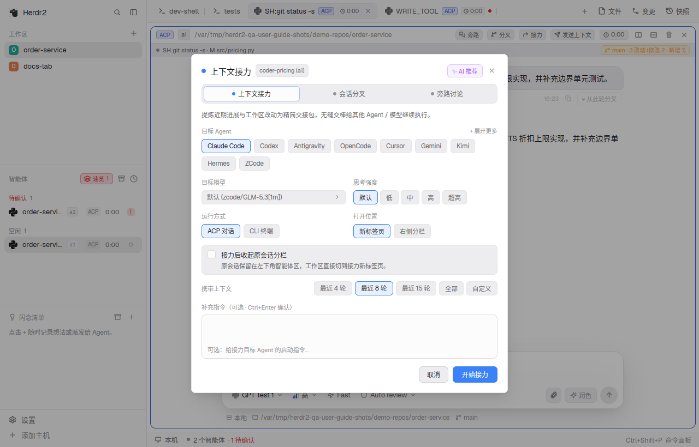
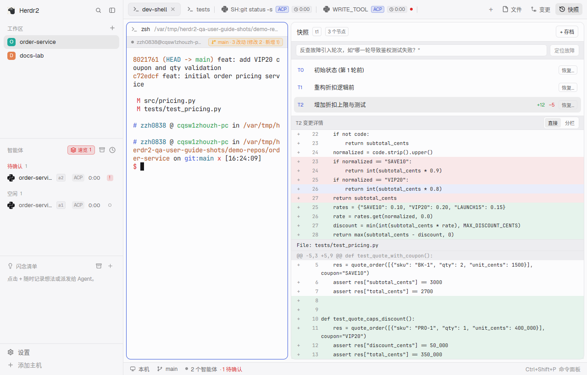
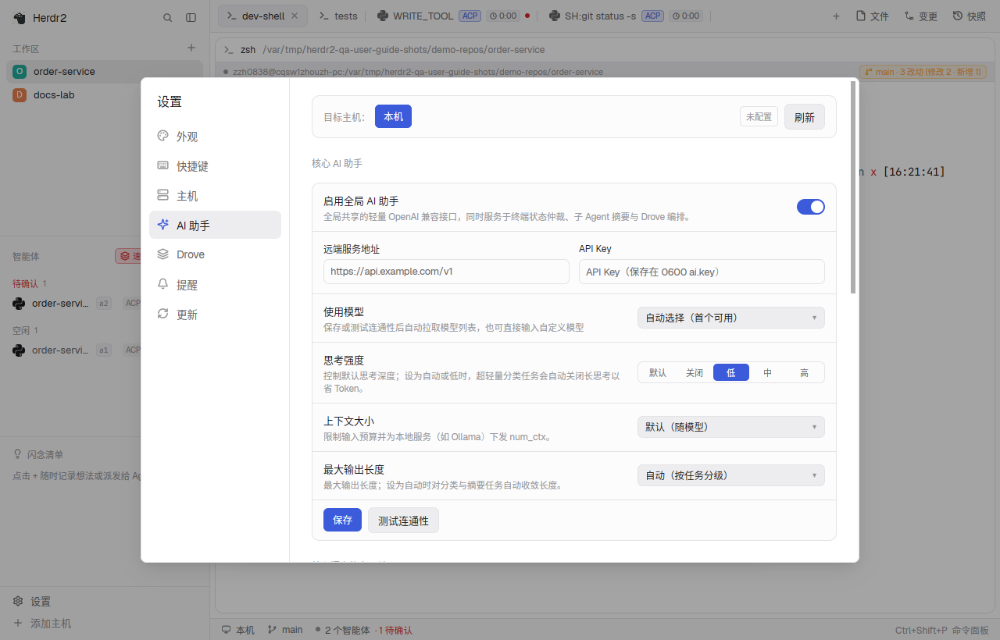

# 04. 上下文接力、快照回滚与全局 AI 助手

> 本篇介绍 Herdr2 最能显著提升工程上限的三大「护城河」能力：**上下文接力与分叉（Handoff / Fork）**、**无污染 Git 快照与故障定位（Checkpoints）**，以及轻量级的**全局 Core AI 助手**。

---

## 1. 上下文接力、会话分叉与旁路讨论

在深度开发中，你经常会遇到这三种痛点：
1. 当前 Agent 对话太长、上下文接近上限或额度耗尽，想换另一个模型/工具继续干，但不想重新把背景讲一遍。
2. 做到一半发现有两个设计方案，想在不破坏主会话的前提下，分别试跑方案 A 和方案 B。
3. 想针对刚生成的某段代码问几个原理性问题，又不想把这些闲聊塞进主任务上下文里干扰编码。

在任意 ACP 对话或终端顶部点击 **「接力」 / 「分叉」 / 「旁路」**（或运行 `herdr2 do agent.handoff`），即可呼出**上下文流转弹窗**：



### 三种模式对比

| 模式 | 做了什么 | 典型使用场景 |
| --- | --- | --- |
| **上下文接力（Handoff）** | 提炼近期对话进展 + 当前 Git 工作区改动为精简交接包，交给**任意目标 Agent / 模型**无缝接棒 | 用 Claude 做完架构设计后，切给 Codex 写底层代码；或对话过长时「瘦身重启」 |
| **会话分叉（Fork）** | 从当前轮次（或点击历史消息下的「从此轮分叉」）拷贝上下文开启平行分支，可选**自动创建独立 Git Worktree** | 同时探索两种重构方案；或保留主线不动，在分叉里大胆做破坏性实验 |
| **旁路讨论（Side-chat）** | 在右侧边栏打开轻量化侧边对话，共享背景摘要但**不污染原主会话历史** | 边看代码边问「这段锁顺序会不会死锁」，问完即关 |

在弹窗中，你可以精细控制：
- **目标 Agent 与模型**：支持跨 14 种预设自由切换，点击右上角 **「AI 推荐」** 还能让 Core AI 自动推荐最匹配当前任务的 Agent 与交接模式。
- **运行方式与打开位置**：选择以 `ACP 对话` 或 `CLI 终端` 启动，在 `新标签页` 或 `右侧分栏` 打开。
- **携带上下文范围**：按 `最近 4 轮`、`最近 8 轮`、`最近 15 轮`、`全部` 或 `自定义轮次范围` 精确裁剪，并可附加一句新的启动指令。
- **接力后收起原会话分栏**：勾选后原会话退居左下角智能体列表保留存档，工作区立刻切到新接力会话。

### CLI 一键接力

```bash
# 将 a1 的最近 8 轮上下文接力给 codex 并在新会话中继续执行
h2 handoff a1 --preset codex --recent-turns 8 --prompt "基于当前改动补齐集成测试"

# 在隔离 Git Worktree 中分叉 a1，互不干扰工作区文件
h2 handoff a1 --kind fork --worktree --prompt "尝试用状态机重写折扣计算器"
```

---

## 2. 快照与一键回滚（Checkpoints）

让 AI 直接改代码时，最怕的不是某一步写错，而是「改了三轮之后发现第一轮就引入了隐蔽 Bug，却和自己手改的代码搅在一起，不敢轻易 `git reset --hard`」。

Herdr2 内置了基于**隐藏 Git Ref（`refs/herdr2/...`）**的**快照引擎**：
- **零 Git 历史污染**：所有快照只作为隐藏对象保存在 Git 对象库中，**不会产生任何临时 Commit，不改写你的 `HEAD` 或分支历史**。
- **自动 + 手动双轨存档**：ACP 智能体每完成一轮修改会自动打点；你也可以随时点击右上角 **「+ 存档」** 或运行 `h2 checkpoint snap` 给当前工作区贴一个带书签名的快照。

点击主窗口右上角的 **「快照」** 按钮，即可展开完整的轮次时间轴：



核心功能一览：
1. **轮次时间轴（T0 / T1 / T2…）**：清晰展示每次存档的书签名（如 `T1 重构折扣逻辑前`、`T2 增加折扣上限与测试 +12 -5`）。
2. **纯净轮次 Diff**：点击任意节点，下方立即展示**这一轮独有的真实代码增量**（支持 `直接` / `分栏` 视图切换），剥离无关噪音。
3. **一键恢复（Rollback）**：点击任意历史节点右侧的 **「恢复…」**，可选择仅回滚对话状态，或将**对话与工作区文件同步恢复**到该轮次的精确状态。
4. **自然语言故障定位（Bisect）**：在顶部输入框描述异常现象（如 `哪一轮导致折扣上限单测失败？`）并点击 **「定位故障」**，系统会结合各轮次纯净 Diff 帮你快速缩小引入 Bug 的罪魁轮次。

### 对应的 `h2 checkpoint` CLI 命令

```bash
# 手动为当前终端/智能体打一个带标签的快照
h2 checkpoint snap t1 --label "重构折扣逻辑前"

# 查看所有轮次快照列表
h2 checkpoint ls t1

# 查看任意两轮之间的纯净 Diff
h2 checkpoint diff t1 --from 1 --to 2

# 一键回滚到第 1 轮状态（含工作区文件）
h2 checkpoint rollback t1 --turn 1 --workspace

# 使用 CLI 执行故障轮次定位
h2 checkpoint bisect t1 --symptom "VIP20 折扣上限测试失败"
```

---

## 3. 全局 Core AI 助手配置与能力

除了具体干活的编码 Agent（Claude/Codex/Gemini 等），Herdr2 内部还设有一个轻量级的**全局 AI 控制面（Core AI）**，专门负责各种高频、低延迟的「辅助智能」任务，避免大材小用消耗昂贵的主编码额度。

按 `Ctrl+,` 打开设置，切换到左侧 **「AI 助手」** 即可配置：



### 配置步骤
1. 打开 **「启用全局 AI 助手」** 开关（可按目标主机独立配置，支持本机和已连接的远程主机）。
2. 填入任意 **OpenAI 兼容接口地址**（例如企业网关、云端兼容 API，或本地 `Ollama` / `vLLM` 地址 `http://127.0.0.1:11434/v1`）与 **API Key**（自动以 `0600` 权限安全保存在本地 `ai.key` 文件中，不写入明文配置）。
3. 点击 **「测试连通性」** 并 **「保存」**，系统会自动拉取可用模型列表。
4. 推荐将 **思考强度** 保持在 `低` 或 `默认`：Herdr2 会在终端状态分类等超轻量任务中自动关闭长思考，兼顾秒级响应与极低 Token 开销。

### 配置完成后自动解锁的 6 项提效能力

| 能力 | 触发方式 | 作用说明 |
| --- | --- | --- |
| **提示词一键润色** | 对话框点击「润色」或快捷键触发 `prompt.polish`（支持 `prompt.polish_undo` 撤销） | 把随手写的碎片想法整理成结构清晰、含验收标准的工程 Prompt |
| **Git 提交说明生成** | 右侧「变更」面板底部点击「AI 生成」 | 读取真实工作区 Diff，直接生成规范的 Commit Message |
| **接力/分叉智能推荐** | Handoff 弹窗右上角点击「AI 推荐」 | 根据当前会话上下文与文件改动，推荐最合适的目标 Agent 与交接策略 |
| **智能体摘要与语义标题** | 自动在后台静默运行 | 为左侧智能体列表和标签页生成简短语义标题与进度微摘要 |
| **Catch-up 回归简报** | 命令面板运行 `agent.briefing` | 离开工位一段时间回来后，一键汇总所有待审批阻塞项、已完成任务与批量审批建议 |
| **Drove 角色一键配置** | 「设置 → Drove」页点击「AI 一键配置」 | 结合本机已安装的 Agent 清单，自动为程序员/测试员/审查员等角色匹配首选模型与擅长标签 |

---

**上一篇**：[← 03. 无头 ACP 智能体与权限控制](./03-headless-acp-agents.md) ｜ **下一篇**：[05. Drove 多智能体 DAG 编排 →](./05-drove-orchestration.md)
