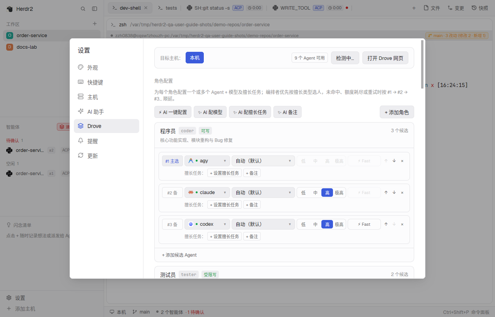
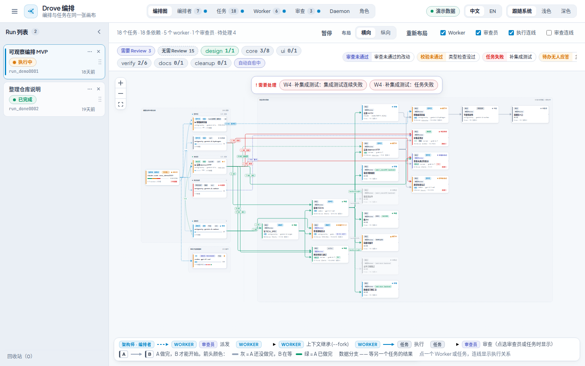
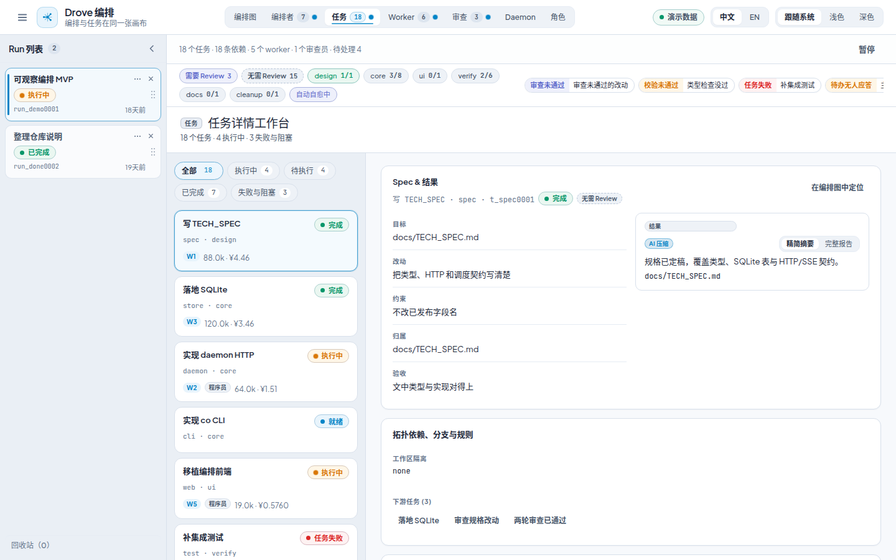

# 05. Drove 多智能体 DAG 编排

> 当需求跨多个模块、需要「编码 + 测试 + 文档 + 异构审查」协同推进时，单智能体串行开发会受限于上下文长度和盲点。**Drove** 是内置于 `h2` 的原生多智能体 DAG 编排引擎，让你用一条命令指挥一支分工明确、权限隔离、自动验收的 AI 工程小队。

---

## 1. Drove 的核心工作机制

Drove 运行在 `h2` 单守护进程内，通过**任务有向无环图（DAG）**管理完整交付生命周期：


四大核心保障：
1. **角色权限护栏（Guardrails）**：每个内置角色拥有独立的写权限等级（`writable` 可写、`scoped_write` 受限写、`readonly` 只读），并在操作系统层结合沙盒（Linux `bwrap` / macOS `sandbox-exec` / Windows Restricted Token）强约束防越界。
2. **多候选故障顺延（Fallback）**：为同一角色配置多个 Agent 候选链（`#1 主选 → #2 备选 → #3 备选`），某模型限流、额度耗尽或超时失败时自动顺延重试。
3. **Git Worktree 并发隔离与合并**：多个并行写任务各自在独立 Worktree 分支施工，通过验收门禁与代码审查后自动汇总合回，彻底告别文件踩踏。
4. **异构交叉审查（Adversarial Review）**：由不同于编码者的模型担任只读审查员，避免「自己审自己」的盲区。

---

## 2. 在桌面端配置 Drove 角色与 Agent 团队

按 `Ctrl+,` 打开设置，进入左侧 **「Drove」** 页面：



### 内置角色与写权限模型

| 角色 ID | 中文名 | 写权限级别 | 典型职责 |
| --- | --- | --- | --- |
| `coder` | 程序员 | `可写 (writable)` | 核心功能实现、模块重构与 Bug 修复 |
| `tester` | 测试员 | `受限写 (scoped_write)` | 单元/集成测试编写、故障复现与回归验证 |
| `writer` | 技术作家 | `可写 (writable)` | 技术文档、架构说明与图表撰写 |
| `illustrator` | 配图师 | `可写 (writable)` | 架构图、流程图、时序图与 SVG 矢量图绘制 |
| `reviewer` | 审查员 | `只读 (readonly)` | 异构代码审查、并发安全与架构审计 |
| `researcher` | 调研员 | `只读 (readonly)` | 跨仓源码检索、架构摸底与日志分析 |

### 推荐配置技巧
- **多候选顺延**：如图所示，为 `coder` 配置 `#1 主选 agy`、`#2 备 claude`、`#3 备 codex`，并按需指定模型与思考深度（低 / 中 / 高 / 极高）。
- **擅长任务标签**：点击 `+ 设置擅长任务`（例如「后端架构」「复杂重构」「前端 UI」），编排者会优先把对应类型任务派给最擅长的候选模型。
- **AI 一键配置**：若已配置「AI 助手」，点击顶部 **「AI 一键配置」** 即可自动扫描本机可用 Agent 并完成合理分配；也可以点击 **「+ 添加角色」** 定义团队专属角色。
- 点击右上角 **「打开 Drove 网页」** 即可直达本地只读可视化工作台（默认 `http://127.0.0.1:7799`）。

---

## 3. 从命令行驱动 Drove（`h2 drove`）

除了通过支持 `/drove` 的主协调 Agent 自动生成 DAG 外，你也可以用 `h2 drove` 全流程观测与干预：

```bash
# 查看当前所有 Run 列表
h2 drove ls

# 从任务规划文件启动一个多任务 DAG Run
h2 drove plan --file plan.json

# 或快速发起一个轻量级临时任务 Run
h2 drove quick --goal "为 pricing.py 补充边界测试并审查变更"

# 查看某个 Run 的实时任务进度、Worker 状态与审查结果
h2 drove inspect <run_id>

# 向运行中的 Run 追加新任务
h2 drove add <run_id> --title "补齐用户手册说明" --role writer --depends-on <task_id>

# 阻塞等待事件（任务完成、审批阻塞、失败告警）
h2 drove wait <run_id>

# 查看并回复编排者收件箱消息（处理卡点或人工决策）
h2 drove inbox <run_id>
h2 drove reply <run_id> <msg_id> --body "同意改用方案 B，继续执行"

# 暂停 / 恢复 / 重试失败任务 / 取消 Run
h2 drove pause <run_id>
h2 drove resume <run_id>
h2 drove retry <run_id> <task_id>
h2 drove cancel <run_id>
```

---

## 4. Drove Web 可视化编排工作台

Drove 内置了一套轻量、零侵入的只读 Web 监控面板（默认监听 `http://127.0.0.1:7799`，端口可通过环境变量 `H2_DROVE_PORT` 自定义），通过 SSE 实时推送每个节点的状态、耗时、Token/费用与审查流转。

### 4.1 实时 DAG 编排图

在 **「编排图」** 视图中，你可以一眼看清整个工程的全局脉络：



画面核心元素解读：
- **左侧 Run 列表**：快速切换「执行中」「已完成」的历史 Run，支持改名、拖拽排序与回收站管理。
- **顶部筛选胶囊与告警条**：一键按「需要 Review / 无需 Review」「阶段（`design` / `core` / `ui` / `verify` / `docs`）」筛选节点；出现测试失败、审查打回或无人应答时，顶部红色 **`! 需要处理`** 胶囊会直接定位故障任务。
- **可视化关系连线**：
  - 左侧为 **架构师·编排者** 与按角色分组的 **Worker / 独立审查员** 卡片；
  - 右侧为带拓扑依赖的任务卡片（绿线 = 上游已完成，灰线 = 等待上游，虚线 = 数据分支或审查连线）；
  - 支持 **横向 / 纵向** 一键切换布局，并可按需开关 `Worker`、`审查员`、`执行连线` 与 `审查连线`。

### 4.2 任务详情工作台

点击画布上的任意任务卡片，或切换顶部导航至 **「任务」**，进入结构化任务详情工作台：



在这里你可以完整回溯每个任务的来龙去脉：
- **左侧状态筛选列表**：按 `全部` / `执行中` / `待执行` / `已完成` / `失败与阻塞` 过滤，每条任务一目了然地展示执行 Worker、Token 用量与估算开销。
- **右侧 Spec & 结果卡片**：完整呈现该任务的目标文件、改动要求、约束边界与验收条件，并提供 **「精简摘要（AI 压缩）」** 与 **「完整报告」** 一键切换。
- **拓扑依赖、分支与规则**：清晰列出 Worktree 工作区隔离方式以及下游依赖任务，方便快速定位级联影响。

> [!TIP]
> 想先体验 Drove Web 的完整交互而暂时不想真跑一轮多智能体任务？在浏览器访问 `http://127.0.0.1:7799/?mock=1` 即可加载内置的真实感**演示数据**画布（顶部会显示绿色 `演示数据` 徽标），随心体验横向/纵向布局、任务详情、Worker 面板与审查记录！

---

**上一篇**：[← 04. 上下文接力、快照回滚与全局 AI 助手](./04-handoff-checkpoints-and-ai.md) ｜ **下一篇**：[06. 远程主机、深度定制与自动化自检 →](./06-remote-customization-and-qa.md)
