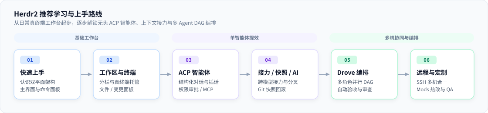

# Herdr2 用户使用手册（User Guide）

欢迎来到 **Herdr2** 用户使用手册！

**Herdr2** 是一款面向现代 AI 辅助软件工程的**双平面工作台与智能体编排运行时**：它把**真终端（Ghostty/PTY）**、**无头结构化 ACP 智能体**、**Git 快照与上下文接力**以及**多智能体 DAG 编排引擎（Drove）**统一到同一个高性能原生窗口与后台守护进程（`h2`）之中。

> [!TIP]
> 本系列文档中的所有操作流程均已在独立沙盒环境中实际复现，配图均为 Herdr2 桌面端（GPUI）与 Drove Web 的真实运行截图。

---

## 一句话理解 Herdr2

- **关闭窗口，一切照常运行**：终端（`t*`）与智能体（`a*`）全部托管在后台守护进程 `h2` 中，重启窗口、升级 UI 甚至断开 SSH 都不会中断正在跑的编译或 Agent 会话。
- **终端与对话，各取所长**：需要交互式 Shell、Vim、本地 TUI 工具时用 **Ghostty 真终端（`t*`）**；需要派发后台 AI 编码/调研/审查任务时用 **无头 ACP 智能体（`a*`）**，享受结构化对话、行内权限审批、附件与零终端污染。
- **上下文可继承、改动可回滚**：支持跨 Agent/跨模型的**上下文接力（Handoff）与会话分叉（Fork）**，并通过基于隐藏 Git Ref 的**轮次快照（Checkpoints）**实现纯轮次 Diff 对比与一键回滚。
- **从单兵到军团**：内置轻量单守护进程编排器 **Drove**，把复杂需求拆解为带依赖、隔离 Worktree、自动验收与异构代码审查的任务有向无环图（DAG）。

---

## 文档目录与阅读路线

| 篇目 | 文档 | 核心主题 | 适合人群 |
| --- | --- | --- | --- |
| **01** | [快速上手与界面导览](./01-getting-started.md) | 核心理念、启动与欢迎向导、主界面 5 大区域、命令面板、5 分钟上手闭环 | 所有新用户 |
| **02** | [工作区、终端与代码面板](./02-workspaces-and-terminals.md) | 工作区/标签页/分栏、常用快捷键、Ghostty 真终端与 `h2` 托管、文件/变更/快照三面板、闪念清单 | 日常开发用户 |
| **03** | [无头 ACP 智能体与权限控制](./03-headless-acp-agents.md) | 14 种内置 Agent 预设、桌面与 CLI 启动、结构化对话视图、串行收件箱与 `--steer`、权限审批、运行时切模型、内置 MCP 与子智能体树 | AI 编码主力用户 |
| **04** | [上下文接力、快照回滚与全局 AI 助手](./04-handoff-checkpoints-and-ai.md) | 接力（Handoff）/ 分叉（Fork）/ 旁路讨论、隐藏 Git Ref 快照与故障定位（Bisect）、全局轻量 Core AI（提示词润色、提交说明、Catch-up 简报） | 进阶提效用户 |
| **05** | [Drove 多智能体 DAG 编排](./05-drove-orchestration.md) | 角色与故障顺延配置、权限护栏与 Worktree 合并、从 `h2 drove` 启动到监控、Drove Web 可视化编排画布与任务详情工作台 | 复杂任务与多 Agent 协作 |
| **06** | [远程主机、深度定制与自动化自检](./06-remote-customization-and-qa.md) | SSH 远程主机多机合一、外观/主题/三套内置布局、Layouts 与 Mods 热重载定制、基于隔离沙盒的 AI 自动化 QA 测试 | 高级用户与贡献者 |

---

## 核心概念速查表

| 术语 | 标识符 / 位置 | 说明 |
| --- | --- | --- |
| **`h2`（herdr-core）** | 后台守护进程 + CLI | 负责托管所有 PTY 终端、无头 ACP 智能体、快照、AI 控制面与 Drove 编排引擎。 |
| **`Herdr2`（herdr-app）** | 原生桌面窗口（GPUI） | `h2` 的高性能 GPU 桌面客户端，负责工作区、标签页、分栏、代码面板与对话渲染。 |
| **交互式终端** | `t1`, `t2`, ... | 托管在 `holder` 中的真 PTY 终端，桌面端用 `libghostty-vt` 渲染，可随时 `attach` 或远程操控。 |
| **无头 ACP 智能体** | `a1`, `a2`, ... | 通过标准输入/输出 JSON-RPC（ACP v1）通信的结构化智能体，不分配 PTY，零 `TERM*` 污染。 |
| **工作区（Space）** | 左侧边栏顶部 | 按项目目录（及所属主机）组织的独立工作上下文，内含多个标签页（Tab）与分栏（Pane）。 |
| **快照（Checkpoint）** | 右侧「快照」面板 / `h2 checkpoint` | 存于隐藏 Git Ref 下的无污染工作区树快照，不修改你的正常 Git 分支和提交历史。 |
| **Drove** | `h2 drove` / `http://127.0.0.1:7799` | 原生多智能体 DAG 编排器，自动调度多角色 Worker、执行验证门禁与异构代码审查。 |

---

## 推荐上手顺序

准备好了吗？让我们从 **[第 01 篇：快速上手与界面导览](./01-getting-started.md)** 开始。
