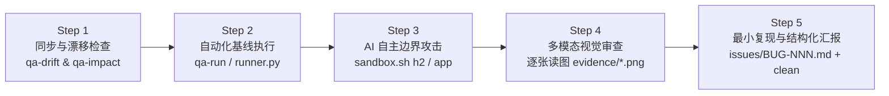
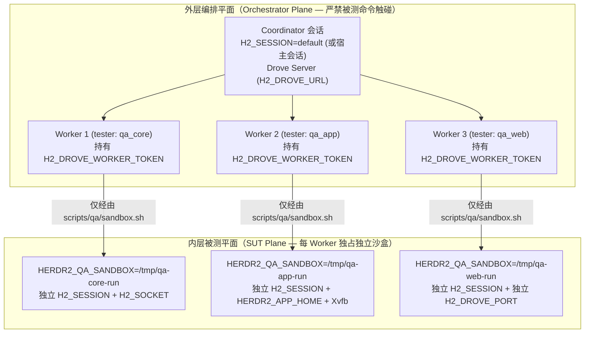

# Herdr2 自主测试、活清单同步与缺陷汇报操作手册（SOP）

本手册面向执行 **Herdr2**（`herdr-core` / `h2`、`herdr-app` / `herdr2`、`drove-web`）质量验证的 AI Agent，定义从**活清单漂移同步 → 自动化基线执行 → AI 自主边界攻击 → 多模态视觉审查 → 最小独立复现与结构化汇报**的完整闭环流程。

---

## 1. 何时触发（Trigger Scenarios）

当用户提出以下任一诉求（中文或英文）时立即激活本 Skill：

- **全量或分层自动测试**：“跑一遍 Herdr2 自动测试”、“跑一轮 L0-L3 验证”、“Run Herdr2 QA suite”
- **变更影响面回归**：“测试这次改动”、“验证我刚改的命令 / Mod / RPC 有没有问题”、“Test my recent changes”
- **活清单与用例同步**：“同步测试用例”、“检查 QA 覆盖漂移”、“补齐新功能的 QA 用例并刷新目录”、“Sync QA catalog / check drift”
- **探索性测试与自动找 Bug**：“对 Herdr2 做探索性测试”、“压测边界情况和异常恢复”、“UI 视觉检查 / 截图走查”、“自动找 Bug 并提单”

---

## 2. 安全隔离红线（Safety & Isolation Red Lines）

> **铁律：零宿主污染、零真实窗口干扰、零残留进程。违反任意一条均视为严重测试事故。**

1. **严禁触碰宿主机默认环境与真实桌面**：
   - **严禁**直接操作默认 `H2_SESSION`（未设置或 `default`）或继承自父级编排环境的活跃会话套接字（`$H2_SOCKET`、`$H2_AGENT_SOCKET`、`$H2_TERMINAL_SOCKET`）；
   - **严禁**读写、覆盖或清理用户真实目录 `~/.config/herdr2*`（含 `~/.config/herdr2/`、`~/.config/herdr2-app/`）与 `~/.local/state/herdr2`；
   - **严禁**连接宿主机正在运行的真实 `Herdr2` 桌面窗口，严禁在用户真实桌面（真实 `DISPLAY` / `WAYLAND_DISPLAY`）上执行窗口动作、键鼠注入、语言/缩放修改或运行 `h2 server stop/restart`。
2. **唯一合法操作入口：`scripts/qa/sandbox.sh`**：
   - 一切针对被测系统（SUT）的 CLI 调用、守护进程生命周期管理、桌面窗口驱动与截图，**必须**经由 `scripts/qa/sandbox.sh` 在独立的 `HERDR2_QA_SANDBOX` 沙盒内执行。
   - 沙盒内部会自动隔离 `H2_SESSION`、`H2_SOCKET`、`XDG_CONFIG_HOME`、`XDG_STATE_HOME`、`HERDR2_APP_HOME`、`H2_DROVE_PORT` 及离屏/虚拟显示环境，并屏蔽外层会话身份变量（`H2_AGENT_ID`、`H2_TERMINAL_ID` 等）。
3. **强制清理闭环（Always `clean`）**：
   - 每次手动拉起沙盒（`scripts/qa/sandbox.sh up`）完成测试后——**无论测试通过、失败还是中途报错**——结束前**必须**执行 `scripts/qa/sandbox.sh clean`，彻底销毁沙盒内的 `h2` 守护进程、`holder` 进程、`herdr2` 窗口、虚拟显示服务及临时目录。

```bash
# 推荐用法：为单次任务显式指定独立的沙盒根目录，并在收尾时强制 clean
export HERDR2_QA_SANDBOX="/tmp/herdr2-qa-$(date +%s)-$$"
scripts/qa/sandbox.sh up
# ... 所有被测操作均通过 scripts/qa/sandbox.sh h2 / app 执行 ...
scripts/qa/sandbox.sh clean
```

> **提示**：执行前可先运行 `scripts/qa/sandbox.sh --help`、`python3 scripts/qa/runner.py --help` 与 `just --list` 核对当前仓库支持的全部子命令与可选参数。

---

## 3. 标准 5 步执行流（Standard 5-Step Execution SOP）

按顺序严格执行以下 5 个步骤，不得跳过漂移检查、真实读图审查或独立复现验证。



### Step 1：同步与漂移检查（Drift & Impact Check）

先检查源码表面（OpenRPC Schema、`h2` CLI 子命令、`herdr-app` 窗口命令、`defaults/mods/*` 与 `defaults/frame/*`）与活测试清单是否一致，并定位本次改动波及的特性与用例：

```bash
just qa-drift
just qa-impact
```

- **发现未覆盖项时的强制动作**：若 `just qa-drift` 或 `just qa-impact` 报告源码新增/修改了 RPC、CLI 命令、窗口动作或 UI Mod，而 `qa/features.yaml` 或 `qa/cases/*.yaml` 尚未覆盖：
  1. **先补齐** `qa/features.yaml` 功能映射与对应的 `qa/cases/*.yaml` 测试用例（包含自动化步骤与 `ai_probe_hints`）；
  2. 运行 `just qa-catalog` 重新生成 `qa/CATALOG.md`；
  3. 再次运行 `just qa-drift` 确认无遗漏、格式合法后，再进入 Step 2。

### Step 2：自动化基线执行（Automated Baseline Execution）

根据任务目标选择增量范围或分层全量执行基线自动化套件：

```bash
# 方式 A：默认按配置运行 QA 套件
just qa-run

# 方式 B：仅针对最近代码变更（如 HEAD~1 或指定基准提交）做增量精准回归
python3 scripts/qa/runner.py --since HEAD~1

# 方式 C：按测试层级（L0-L3）运行全套或指定层级验证
python3 scripts/qa/runner.py --tier L0,L1,L2,L3
```

**分层说明（L0–L3）**：
- **L0（静态契约与冒烟）**：Schema 校验、`h2 --version` / `h2 schema` / `herdr2 commands` / `herdr2 check` Mod 静态渲染预检；
- **L1（Core 与协议集成）**：沙盒内 `h2` 守护进程、PTY 终端（`t*`）、无头 ACP 会话（`a*`）、串行 Inbox / `--steer`、权限状态机、文件与 `checkpoint` 操作；
- **L2（Desktop UI 与窗口编排）**：沙盒离屏窗口启动、`space/tab/pane` 布局控制、Mod 加载状态（`status` 零报错）、中英文切换与渲染帧截图（`shot`）；
- **L3（端到端复合流与韧性）**：`server restart` 会话恢复（`--keep`）、父子联动清理（`die_with_parent`）、Drove DAG 编排与 `drove-web` 接口验证。

记录本次运行生成的 `<run_id>` 及产物目录 `qa/reports/<run_id>/`（含执行摘要、日志与 `evidence/*.png`）。若基线用例失败，记录失败用例 ID 与日志，留待 Step 5 区分“真代码缺陷”与“用例过时”。

### Step 3：AI 自主探索与边界攻击（AI Exploratory & Boundary Probing）

自动化脚本只覆盖固定路径。AI **必须**阅读受影响 `qa/cases/*.yaml` 中的 `ai_probe_hints` 字段及改动源码，亲自驱动沙盒发起至少一轮针对性边界探测：

```bash
export HERDR2_QA_SANDBOX="/tmp/herdr2-qa-probe-$$"
scripts/qa/sandbox.sh up

# 1) Core / CLI 边界探测示例
scripts/qa/sandbox.sh h2 server status
scripts/qa/sandbox.sh h2 exec --cwd "/tmp" -- echo "sandbox-ok"

# 2) Desktop App 控制与现场取证示例
scripts/qa/sandbox.sh app status
scripts/qa/sandbox.sh app ls
scripts/qa/sandbox.sh app do space.new --name "中文 空格 Space" --folder "$HERDR2_QA_SANDBOX/测试 目录 (1)"
scripts/qa/sandbox.sh app do app.language --language zh-CN
scripts/qa/sandbox.sh app shot "qa/reports/<run_id>/evidence/probe-zh-space.png"
```

**五大必测攻击维度**（按受影响模块挑选组合）：
1. **非法参数与类型边界**：未知参数名、非字符串 Target ID（如给 `pane` / `terminal` 传数字 `123` 或布尔值）、缺失必填字段、空串/超长字符串、非法枚举值（验证返回清晰结构化报错且进程不崩溃、不弹窗卡死）；
2. **特殊路径与字符集**：包含**中文、空格、括号、引号或 Emoji** 的工作区目录（如 `测试 目录 (v1)`）、多字节 UTF-8 终端输出流与长行折行；
3. **并发竞争与高频连击**：快速连续执行 `space.new` → `pane.split` → `pane.swap` → `pane.detach` → `space.close`，或对同一无头 Agent 连续 `h2 send` 叠加 `--steer` / `interrupt` / `kill`；
4. **守护进程重启与断连恢复**：启动带 `--keep` 的终端或 ACP 会话后执行 `scripts/qa/sandbox.sh h2 server restart`，验证会话恢复、状态不丢失、无孤儿残留进程，以及桌面端 `status` 自动重连恢复；
5. **Mod 静态健康与运行态一致性**：对涉及改动的内置/自定义 Mod 执行 `scripts/qa/sandbox.sh app check <mod_path>`，并在窗口操作后检查 `scripts/qa/sandbox.sh app status` 中不存在隐藏的 JS / 文件加载错误。

### Step 4：AI 多模态视觉审查（Multimodal Visual Inspection）

> **严禁未读图就宣称“UI 正常”！** 命令返回 `exit 0` 仅代表渲染帧已落盘，不代表画面正确。

使用多模态读图工具（如 `read_file` 直接读取 `.png` 文件）**逐张**检查 `qa/reports/<run_id>/evidence/*.png`（包括自动化产出与 Step 3 手动抓取的截图），逐项排查以下 **5 类视觉缺陷**：

1. **黑屏 / 空白 / 未完成首帧渲染**：整窗纯黑、纯白、终端区域空白无提示符、组件骨架未加载完成；
2. **文字重叠 / 截断异常 / 溢出越界**：窄分屏、高缩放（`app.zoom_in`）或多标签页挤压下，标题栏、侧栏 `Agents` 树、底部状态栏或按钮文字互相重叠、缺少省略号直接硬切或超出容器边界；
3. **中英文翻译遗漏（i18n 漏翻与混排）**：切换 `zh-CN` 后界面仍残留未翻译英文词条或原始 i18n key，或切换 `en` 后残留硬编码中文；
4. **暗亮主题对比度与状态辨识度**：前景文字与背景色对比度过低难以阅读、选中/聚焦边框不可见、`working` / `blocked` / `done` / `ACP` 状态徽标颜色失真；
5. **弹窗遮挡与图层残留**：`terminal.peek`、`app.palette`、`app.settings`、`new-menu`、`toast` 打开时遮挡关键交互控件或超出窗口可视区，关闭后遮罩/残影未清除。

### Step 5：独立复现与结构化汇报（Minimal Reproduction & Structured Reporting）

1. **独立最小复现铁律**：
   - 任何疑似 Bug 在写入 `issues/BUG-NNN.md` 之前，**必须**开启一个全新的干净沙盒（`scripts/qa/sandbox.sh clean && scripts/qa/sandbox.sh up`），用**最短、无多余前置依赖的命令序列**独立重现一次；
   - 无法稳定复现的偶发异常，需至少补充 3 次重试观察，若确属竞态条件（Race Condition），在报告中注明复现概率与触发条件，不得凭猜测臆造缺陷；
   - 若确认是测试用例断言过时而非产品缺陷，直接修复对应 `qa/cases/*.yaml` 并重跑验证，不记为产品 Bug。
2. **严重度分级标准（P0–P3）**：
   - **`P0`（致命 / 阻断发布）**：Core 或 App 崩溃（panic / segfault / 闪退）、用户数据或状态文件损坏、沙盒/权限护栏失效越界、主流程（守护进程启动、PTY 终端读写、ACP 会话运行、主窗口渲染）完全不可用；
   - **`P1`（严重 / 核心受损）**：核心功能失效或死锁挂起（如 `server restart` 丢失 `--keep` 会话、Drove 调度卡死、权限审批无法放行/拒绝、核心面板黑屏或无法交互），且无合理绕过手段；
   - **`P2`（一般 / 局部缺陷）**：边界输入报错模糊或未拦截、特殊字符/空格路径下功能异常、局部 UI 文字重叠/截断/弹窗遮挡、非核心子命令行为与预期不符；
   - **`P3`（轻微 / 体验瑕疵）**：中英文漏翻或术语不统一、细微像素对齐/间距/对比度瑕疵、文案与日志可读性问题。
3. **归档 `issues/BUG-NNN.md`**：
   - 查看 `issues/` 目录下已有编号，按三位递增序号新建 `issues/BUG-NNN.md`（例如 `issues/BUG-001.md`），严格遵循下方模板：

```markdown
# BUG-NNN: <一句话精准描述缺陷现象>

- **Severity**: P0 | P1 | P2 | P3
- **Module**: `herdr-core` | `herdr-app` | `drove-web` | `scripts/qa`
- **Related Case / Feature**: `<case_id / feature_id>`
- **Discovered In**: `<run_id>` (`<git_commit_sha>`)

## 1. 现象摘要（Summary）
简要说明在什么条件下触发了什么错误表现及其影响范围。

## 2. 一键最小复现步骤（Minimal Repro in Isolated Sandbox）
```bash
export HERDR2_QA_SANDBOX="/tmp/herdr2-repro-bug-NNN"
scripts/qa/sandbox.sh clean
scripts/qa/sandbox.sh up
# 最小触发命令序列：
scripts/qa/sandbox.sh h2 ...
scripts/qa/sandbox.sh app do ...
scripts/qa/sandbox.sh clean
```

## 3. 预期行为 vs 实际行为（Expected vs Actual）
- **Expected**: ...
- **Actual**: ...（附精确退出码与 stdout/stderr 关键报错）

## 4. 证据附件（Evidence）
- 日志路径：`qa/reports/<run_id>/...`
- 视觉截图：`qa/reports/<run_id>/evidence/<name>.png`

## 5. 疑似源码位置与根因分析（Suspected Source & Root Cause）
- 疑似文件与行号：`herdr-core/crates/herdr2/src/...:Lxx` 或 `herdr-app/src/...:Lxx`
- 初步根因判断：...
```

4. **沙盒最终清理**：所有复现与取证完成后，执行 `scripts/qa/sandbox.sh clean`，并校验无残留沙盒进程。

---

## 4. Dogfooding 高级模式：用 Herdr2 / Drove 编排并行测试

当需要对 `herdr-core`、`herdr-app`、`drove-web` 进行大规模并行回归与探索测试时，可使用宿主/外层 **Herdr2 + Drove**（`h2 drove plan`）派生多个 `tester` Worker 并行执行——但**必须严守双层隔离原则**，防止 Worker 误连或误杀承载自身的编排守护进程。

### 4.1 双层隔离原则（Orchestrator Session ≠ SUT `HERDR2_QA_SANDBOX`）



1. **外层与内层通道严格分流**：
   - **向编排器汇报状态**（`h2 drove worker inbox / note / ask / done`）：直接调用外层 `h2 drove worker ...`，使用环境预置的 `H2_DROVE_URL` 与 `H2_DROVE_WORKER_TOKEN`；**切勿**在运行 `h2 drove worker` 时覆盖外层环境变量。
   - **执行一切被测操作**：**仅能**通过 `HERDR2_QA_SANDBOX=<worker专属路径> scripts/qa/sandbox.sh ...` 执行。`sandbox.sh` 内部启动独立 `H2_SESSION`、`H2_SOCKET`、`HERDR2_APP_HOME`、离屏显示与独立 `H2_DROVE_PORT`，从而保证内层执行 `sandbox.sh h2 server stop/restart` 时**绝不会自杀外层 Worker 或干扰兄弟 Worker**。
2. **每 Worker 独占沙盒与端口**：
   - 并行 Worker 严禁共享同一个 `HERDR2_QA_SANDBOX` 目录或同一个 `H2_DROVE_PORT` / 虚拟显示编号；必须以任务名或 `$$` 区分（如 `/tmp/herdr2-qa-core-$$`、`/tmp/herdr2-qa-app-$$`、`/tmp/herdr2-qa-web-$$`）。
3. **缺陷编号防冲突**：
   - 并行探索阶段，各模块 Worker 将已独立复现的疑似缺陷先记录在各自报告或交由下游汇总任务统一分配 `issues/BUG-NNN.md` 序号，避免多 Worker 并发抢占同一 `BUG-NNN` 文件名。

### 4.2 分模块并行测试编排示例（`h2 drove plan`）

```yaml
objective: 并行执行 Herdr2 Core / App / Web 全隔离沙盒 QA 与缺陷归档
maxConcurrency: 3
tasks:
  - key: sync_check
    title: QA 漂移检查与活目录刷新
    role: tester
    spec:
      target: qa/
      change: 运行 just qa-drift 与 just qa-impact，补齐缺失用例并执行 just qa-catalog
      acceptance: just qa-drift 零漂移通过
      verify: "just qa-drift"

  - key: qa_core
    title: Core 双平面与守护恢复实测
    role: tester
    deps: [sync_check]
    spec:
      target: qa/reports/
      change: |
        设置独立 HERDR2_QA_SANDBOX=/tmp/h2-qa-core-$$，运行 Core 相关 L0-L3 用例，
        并通过 scripts/qa/sandbox.sh h2 探测非法参数、特殊路径、并发 steer 与 server restart 恢复，结束后 clean。
      acceptance: 基线与边界探测完成，留存报告日志且沙盒已 clean

  - key: qa_app
    title: Desktop App GPUI 交互与多模态视觉审查
    role: tester
    deps: [sync_check]
    spec:
      target: qa/reports/
      change: |
        设置独立 HERDR2_QA_SANDBOX=/tmp/h2-qa-app-$$，运行 App 相关用例，
        经 scripts/qa/sandbox.sh app do/shot 测试分屏、Mod 检查、中英文与缩放切换，逐张读图审查 evidence/*.png，结束后 clean。
      acceptance: 所有截图已完成多模态视觉核验且沙盒已 clean

  - key: qa_web
    title: Drove Web 接口、SSE 与只读边界实测
    role: tester
    deps: [sync_check]
    spec:
      target: qa/reports/
      change: |
        设置独立 HERDR2_QA_SANDBOX=/tmp/h2-qa-web-$$ 与独立端口，验证 Drove HTTP/SSE 状态流与只读护栏，结束后 clean。
      acceptance: Web 接口与边界测试完成且沙盒已 clean

  - key: bug_triage
    title: 汇总独立复现并归档 issues/BUG-NNN.md
    role: tester
    deps: [qa_core, qa_app, qa_web]
    spec:
      target: issues/
      change: |
        汇总三路 QA 发现的疑似问题，在全新 HERDR2_QA_SANDBOX 中逐一最小化独立复现，
        确认后按 P0-P3 标准写入 issues/BUG-NNN.md，最后执行 scripts/qa/sandbox.sh clean。
      acceptance: 每个归档 Bug 均含可一键复现的 sandbox.sh 命令、证据路径与疑似源码定位
```

---

## 5. 开发同步规范（Developer Living-QA Sync Rule）

Herdr2 采用**代码与活测试清单同仓演进**机制。任何开发者或编码 Agent 在完成功能开发或架构变更时，提交前必须同步维护 QA 资产：

1. **何时必须同步更新 QA 清单**：
   - 在 `herdr-core` 新增/修改 JSON-RPC 方法、`h2` CLI 子命令/参数、ACP/PTY 状态流转或 Drove 协议；
   - 在 `herdr-app` 新增/修改内置窗口控制命令（`herdr2 commands`）、快捷键或 `herdr-app/defaults/{mods,frame,layouts,themes}/*`；
   - 在 `drove-web` 新增/修改页面视图、API 消费逻辑或 SSE 事件处理。
2. **四步同步动作**：
   1. 更新 `qa/features.yaml`：登记新特性的 ID、模块归属、关联源码路径与命令/RPC 标识；
   2. 新增或更新 `qa/cases/*.yaml`：编写可自动执行的验证步骤（指定对应 `tier: L0|L1|L2|L3`）以及供 AI 探索测试使用的 `ai_probe_hints`；
   3. 运行 `just qa-catalog`：自动刷新可读总览 `qa/CATALOG.md`（禁止只手改 `qa/CATALOG.md` 而不改 YAML 数据源）；
   4. 运行 `just qa-drift`（必要时配合 `python3 scripts/qa/runner.py --since HEAD~1`）：确保漂移检查 100% 通过、新增用例在 `HERDR2_QA_SANDBOX` 中实测绿灯后再提交。
